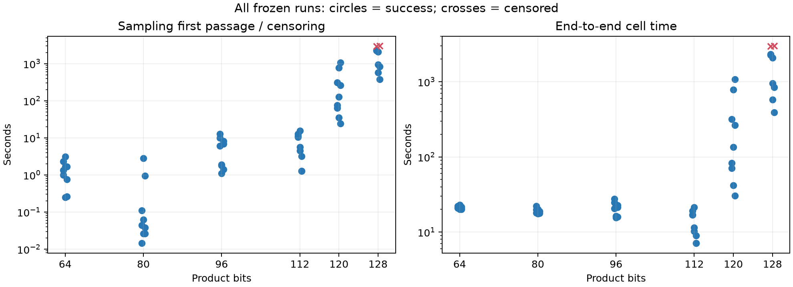
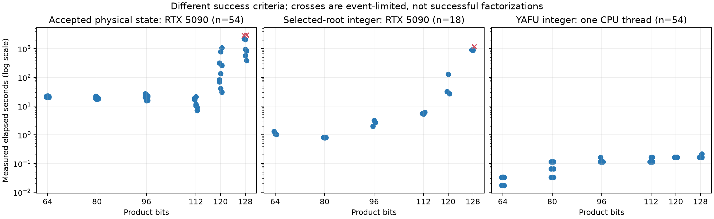

# 算术引导稀疏Ising因式分解：实验报告

[English](experiment-report.md) | 简体中文

最终面板验收：2026-10-19。**单张RTX 5090上，54次冻结运行中的52次取得经过认证的零能量物理态。** 128-bit为7/9，另两次耗尽事件上限；64、80、96、112、120-bit合计45/45成功。这里是18个受限目标、每目标3个seed，不是54个不同实例，也不是通用整数分解基准。

## 1. 问题与方法

给定公开乘积$N$与两个$n$-bit因子寄存器，在完整稀疏乘法器状态上搜索。模型采用compact `carry_chain`存储、非负门／COPY罚项，以及

$$H(s)=C-\sum_i h_i s_i-\sum_{i<j}J_{ij}s_i s_j,\qquad s_i=2x_i-1.$$

只固定product和structural-zero端口。每次从独立物理Rademacher spins开始，已知因子仅用于事后认证。模型有$8n^2-5n$个完整自旋和$8n(n-1)$个自由自旋；128乘积位对应**32,448个完整／32,256个自由自旋**。基础来源包括[可逆p-bit逻辑](#ref-2017-camsari-stochastic-p-bits-invertible-logic)和[COPY稀疏乘法器](#ref-2022-aadit-sparse-ising-machines)。

root候选使用公开算术结构：64-bit为商引导，80-bit为CRT/Fermat，96-bit为四字CRT，112/120/128-bit采用延迟开方。最后一类提案每副本抽取K=262144个候选，用正权重平方剩余预筛，仅对首个通过者精确开方，再独立检查低乘积位，随后生成完整随机电路body。MH使用实际root边际质量和量化整数CDF的body质量：

$$\alpha(x,y)=\min\{1,e^{-\beta[H(y)-H(x)]}q(x\mid y)/q(y\mid x)\}.$$

有限候选库因子只有在支持和权重不依赖当前态时才抵消；均匀尾部与偏置分支重合时质量相加，筛选失败保留整个旧态。命中只检查实际接受态，不检查DAG临时赋值。完整概率约定见[方法说明](method.zh-CN.md)及[Hastings](#ref-1970-hastings)。

选择MH是为了协调改变因子、COPY与进位变量，并校正非对称算术提案；不表示MH普遍优于Gibbs。精确Gibbs更新本身是接受率1的MH特例，见[Chib与Greenberg](#ref-1995-chib-greenberg)。逐门随机生成并非从整个乘法器的完整条件分布抽样。本最终面板没有匹配的128-bit Gibbs对照；冻结配置为beta=12、无局部Gibbs sweep、无PT。正确性与完整支持也不证明大系统能快速达到平衡。

最终执行配置为`buffer_sqrt_qr_v1`，包含随机缓冲复用、整数开方核及融合剩余检查。公开数值／运行源码与实测版本逐文件一致；打包与报告差异见[来源记录](../../provenance/factorization/release-v3.json)。本报告不混入中间优化测量。

## 2. 设备、冻结面板与计时边界

| 设备 | 实际记录 |
|---|---|
| GPU | 单张NVIDIA GeForce RTX 5090，32607 MiB，记录功耗上限500 W |
| 驱动／CUDA | 595.91.07／PyTorch CUDA 13.0构建 |
| CPU | AMD Ryzen 9 7945HX with Radeon Graphics |
| 主机内存 | MemTotal 98056316 kB；进程cgroup上限96392445952 bytes |
| CPU分配 | GPU工作进程亲和性为30个逻辑CPU；YAFU使用1个固定CPU线程 |
| 软件 | Python 3.14.6；PyTorch 2.13.0+cu130；Triton 3.7.1；NumPy 2.4.4；SciPy 1.18.0 |

每个物理结果附带原始设备与软件字段；[依赖锁](../../uv.lock)与[公开冻结协议](protocol.zh-CN.md)给出复现输入。GPU实验和原点回放串行执行；CPU基线可以在单独分配的核心上重叠。已完成证据在后续计算期间传输并核验。

每个位宽按三个公开$N$区间覆盖$N/2^{2n}\in[0.75,0.875)$；因子为两个不同的$n$-bit质数，相对间隔至少0.1。参数不使用因子答案。该范围是受限平衡半素数，不是任意整数。面板在最终执行前冻结；执行配置选定后，target-0夹具曾用于兼容性与上限校准，因此不称为完全未见的性能测试。同一目标／角色seed组合的重复测量不合并为新增独立试验。

严格成功要求实际接受态的非平凡整数乘积正确、自旋合法、**full与conditioned FP64能量均为零**，并通过转移核验。六次指定运行另外完成完整原点回放。全部132项任务为54次物理运行、18次配对selected-root整数控制、54次单线程YAFU控制及6次回放；控制与回放不增加独立物理试验。

采样首中采用记录的观察上界。准备包括模型建立与warmup；认证和分段采集另列。完整cell墙钟包括该运行的准备、采样、证据输出与认证，不包括冷安装、后续传输／审计及单独原点回放。采集与采样重叠，不能重复相加。YAFU墙钟是计时的分解器进程，排除版本化构建。逐运行原始字段均保留。

## 3. 最终结果与图表

下表保留每个位宽全部9次冻结运行。首中中位数／范围**仅对成功运行统计**，cell中位数包括事件上限未命中。样本小且分布受限，不估计TTS99；不同位宽使用不同提案核和副本数，因此不是同一算法的复杂度标度律。

| 位宽 | 严格成功 | 成功首中中位数／秒 | 成功首中范围／秒 | 全运行cell中位数／秒 | 峰值reserved GiB |
|---|---|---|---|---|---|
| 64 | 9/9 | 1.333271 | 0.249215–3.070311 | 21.134627 | 3.713 |
| 80 | 9/9 | 0.044377 | 0.014388–2.807065 | 18.692184 | 2.855 |
| 96 | 9/9 | 5.997098 | 1.100490–12.796780 | 20.488252 | 1.943 |
| 112 | 9/9 | 5.662224 | 1.260776–15.552503 | 11.456806 | 2.074 |
| 120 | 9/9 | 128.035249 | 23.915363–1067.315636 | 134.730049 | 2.080 |
| 128 | 7/9 | 948.686157 | 381.258808–2307.776375 | 2070.297489 | 2.086 |

圆点表示严格成功，叉号表示事件上限观察。完整[CSV](../../data/factorization/release-v3/summary/results.csv)与[汇总](../../data/factorization/release-v3/summary/aggregates.json)保留所有分母。峰值reserved显存是分配器实测，不是模型理论最小内存，也不是设备能耗。

### 完整128-bit面板

| 运行 | 状态 | 事件数 | 首中／秒 | 采样／秒 | cell／秒 |
|---|---|---|---|---|---|
| w128-holdout-0-s0 | strict_hit | 812155 | 2307.776375 | 2307.784397 | 2315.276440 |
| w128-holdout-0-s1 | strict_hit | 725809 | 2062.702358 | 2062.722354 | 2070.297489 |
| w128-holdout-0-s2 | event_limit | 1048576 | — | 2981.062412 | 2985.194211 |
| w128-holdout-1-s0 | strict_hit | 795245 | 2261.345760 | 2261.352639 | 2269.507280 |
| w128-holdout-1-s1 | strict_hit | 201167 | 571.597949 | 571.617555 | 579.183858 |
| w128-holdout-1-s2 | strict_hit | 134080 | 381.258808 | 381.272809 | 388.884611 |
| w128-holdout-2-s0 | event_limit | 1048576 | — | 2942.713694 | 2947.193040 |
| w128-holdout-2-s1 | strict_hit | 337761 | 948.686157 | 948.695869 | 956.241805 |
| w128-holdout-2-s2 | strict_hit | 299182 | 840.289897 | 840.309406 | 847.852709 |

记录中最快的128-bit严格首中为**381.258808采样秒**，该cell完整耗时**388.884611秒**。它是一次成功运行，不是期望求解时间。两次未成功运行均耗尽1,048,576事件，保留在分母中。一次基础设施替代运行使用原始seed重启并与已保存前缀一致；逻辑运行只计一次，不属于更换seed重试。

### 算术贡献与经典控制

| 位宽 | 整数控制成功 | 整数控制cell中位数／秒 | YAFU成功 | YAFU进程中位数／秒 |
|---|---|---|---|---|
| 64 | 3/3 | 1.100020 | 9/9 | 0.033192 |
| 80 | 3/3 | 0.809065 | 9/9 | 0.065921 |
| 96 | 3/3 | 2.696634 | 9/9 | 0.116040 |
| 112 | 3/3 | 5.565105 | 9/9 | 0.115901 |
| 120 | 3/3 | 32.330447 | 9/9 | 0.165467 |
| 128 | 2/3 | 921.598952 | 9/9 | 0.165715 |

selected-root控制保留完整随机布局，仅检查被选中的算术候选，省略电路body和MH；它不是扫描全候选库，也不是优化后的经典分解器。该臂17/18成功，其中128-bit为2/3。[YAFU](#ref-project-bbuhrow-yafu)固定revision `c7d90283972820f99b3b4920bfc1eff05c1f6342`，以`-plan noecm -threads 1`完成**54/54**整数分解，构建见[基线锁](../../baselines/factorization/yafu.lock.json)。三个臂的成功标准与计时边界不同；YAFU在整数任务上明显更快，现有数据不支持经典分解速度优势。

正确roots来自独立于当前物理态的算术提案；完整物理态生成增加成本，也可能损失整数候选。经典分解器找到因子后同样可以构造合法乘法器态，因此证书并非本方法独占能力。本研究另外限制了随机起点、提案与实际接受转移路径。

## 4. 与代表性成果的比较

文献范围于2026-10-18复核。器件数、因子寄存器正确、完整物理态及中间筛关系是不同结果；下表不作为跨硬件速度或能效排名。

| 工作 | 报告范围 | 实现／成功口径 | 比较边界 |
|---|---|---|---|
| [Aadit et al., 2022](#ref-2022-aadit-sparse-ising-machines) | 精确至32-bit；50-bit为近基态评价 | FPGA稀疏乘法器 | 本项目额外使用算术引导，且为GPU模拟 |
| [Jung et al., 2023](#ref-2023-jung-virtual-boltzmann-factorization) | 10–64-bit | FPGA VCBM、退火与整除判定 | 完整物理态表示不同 |
| [Chen et al., 2023](#ref-2023-chen-espin-qfactor) | QFactor至64-bit | 梯度／扰动，规模曲线来自MATLAB | 不把仿真视为64-bit芯片实测 |
| [Lee et al., 2025](#ref-2025-lee-chaotic-oscillator-pbit) | 32/48/64-bit | 混沌p-bit器件配合FPGA／VCBM | 器件随机源与GPU伪随机模拟分别评价 |
| [Duffee et al., 2025](#ref-2025-duffee-integrated-circuit-probabilistic-computer) | V-MTJ为6-bit；修改ASIC为24-bit | 24-bit使用片上伪随机源 | 40/80-bit综合不计为实测分解 |
| [250-MTJ system, 2026](#ref-2026-yang-250-mtj-probabilistic-ising-machine) | 精确24-bit；444个逻辑p-bit | MTJ／FPGA，能量与乘积检查 | 器件数不等于逻辑变量数 |
| [IsingFormer v2](#ref-2025-bunaiyan-isingformer) | 20-bit学习模型、440实例；另有16–24-bit提案研究 | RTX6000 Ada；乘积正确，不要求完整态零能量 | 含训练与离线提案库，优化计时排除建库 |
| [TNSS, 2026](#ref-2026-tesoro-tensor-network-schnorr-sieving) | 完整分解至100-bit | 张量网络、格筛与经典后处理 | 130-bit关系／资源研究不等于完整130-bit分解 |
| [Photonic lattice sieve, 2026](#ref-2026-yang-photonic-lattice-sieve) | 摘要：硬件完整32-bit、仿真完整120-bit | 关系搜索与格筛混合 | 100-bit关系对是中间结果；仅取得摘要 |
| [Gao et al., ISCAS 2026](#ref-2026-gao-48bit) | 摘要主张48-bit结果 | 40 nm CMOS与MTJ设计 | 未取得全文，不依据摘要作定量排名 |
| [CUDA-MPQS v1, 2026](#ref-2026-januszewski-cuda-mpqs) | 作者报告512-bit RSA-155 | 64张H100筛选，单H100线性代数 | 经典二次筛；本项目未独立复现 |
| This project / 本项目 | 128-bit完整物理态认证，7/9运行成功 | 单RTX 5090；算术提案、随机body与MH | 受限分布，保留失败，不具有已证明的经典速度优势 |

可以突出两项有证据的特点：在声明分布上实现**128-bit完整稀疏态认证**；相对IsingFormer等学习提案配置，**无需神经网络预训练**。后者省去训练数据／权重和离线MCMC提案库，但算术建表、编译和采样仍有成本。两点均不代表世界纪录、硬件优势、更好的平衡抽样或泛化；表中更大规模经典GPU结果也说明128-bit不是通用GPU分解纪录。

## 5. 复现与证据

[复现指南](reproduction.zh-CN.md)提供CPU证书检查、图表重建、独立GPU运行与串行原点回放命令。核心数据包含全部物理结果／配置／设备、接受态packet、两类控制及六份已完成原点回放收据；[清单](../../data/factorization/release-v3/inventory.json)绑定文件内容。完整中间轨迹与操作日志保留在私有研究归档。CPU核心核验检查保存的接受态及收据，不冒充重新执行GPU轨迹。

下方参考文献保留研究实际使用的全部论文、项目、网站与软件，包括背景和排除方向。引用不代表复现，不附论文PDF或获取审计。代码与本项目原创材料采用[MIT许可证](../../LICENSE)，外部依赖保留各自许可证。

## 6. 参考文献

引用元数据核对于2026-10-18；保留80篇文献、15个项目和21项技术来源。论文题名保留原文。

### 研究文献

- **[1]** N. Metropolis; Arianna W. Rosenbluth; M. N. Rosenbluth; Augusta H. Teller; Edward Teller. Equation of State Calculations by Fast Computing Machines. 1953. [DOI](https://doi.org/10.1063/1.1699114) · [链接2](https://bayes.wustl.edu/Manual/Metropolis.pdf)

- **[2]** W. K. Hastings. Monte Carlo sampling methods using Markov chains and their applications. 1970. [DOI](https://doi.org/10.1093/biomet/57.1.97)

- **[3]** R. Sherman Lehman. Factoring Large Integers. 1974. 研究时未取得完整正文。 [DOI](https://doi.org/10.1090/S0025-5718-1974-0340163-2) · [链接2](https://www.ams.org/journals/mcom/1974-28-126/S0025-5718-1974-0340163-2/S0025-5718-1974-0340163-2.pdf)

- **[4]** J. Pollard. A Monte Carlo method for factorization. 1975. [DOI](https://doi.org/10.1007/BF01933667) · [链接2](https://pages.cs.wisc.edu/~cs812-1/pollardrho.pdf)

- **[5]** Daniel Brélaz. New methods to color the vertices of a graph. 1979. [DOI](https://doi.org/10.1145/359094.359101) · [链接2](https://cse.unl.edu/~choueiry/Documents/brelaz.pdf)

- **[6]** R. Brent. An improved Monte Carlo factorization algorithm. 1980. [DOI](https://doi.org/10.1007/BF01933190) · [链接2](https://maths-people.anu.edu.au/~brent/pd/rpb051i.pdf)

- **[7]** S. Kirkpatrick; C. Gelatt; M. Vecchi. Optimization by Simulated Annealing. 1983. [DOI](https://doi.org/10.1126/science.220.4598.671)

- **[8]** B. Hajek. Cooling Schedules for Optimal Annealing. 1988. [DOI](https://doi.org/10.1287/moor.13.2.311) · [链接2](https://web.mit.edu/6.435/www/Hajek88.pdf)

- **[9]** Jörn Ilja Siepmann; Daan Frenkel. Configurational bias Monte Carlo: a new sampling scheme for flexible chains. 1992. [DOI](https://doi.org/10.1080/00268979200100061) · [链接2](https://siepmann.chem.umn.edu/publications/3)

- **[10]** Craig Eldershaw; Richard P. Brent. Integer Factorisation on the AP1000. 1995. 1995 年修订作者稿. [链接1](https://maths-people.anu.edu.au/brent/pd/rpb156.pdf) · [链接2](https://maths-people.anu.edu.au/brent/pub/pub156.html)

- **[11]** Koji Hukushima; Koji Nemoto. Exchange Monte Carlo Method and Application to Spin Glass Simulations. 1996. [DOI](https://doi.org/10.1143/JPSJ.65.1604)

- **[12]** L. Tierney. A Note on Metropolis-Hastings Kernels for General State Spaces. 1998. [DOI](https://doi.org/10.1214/aoap/1027961031) · [链接2](https://www2.stat.duke.edu/~scs/Courses/Stat376/Papers/TransdimMCMC/TierneyAAP1998.pdf)

- **[13]** Styliani Consta; N. B. Wilding; Daan Frenkel; Z. Alexandrowicz. Recoil growth: An efficient simulation method for multi-polymer systems. 1999. 1998 预印本；J. Chem. Phys. 110, 3220–3228 (1999). [DOI](https://doi.org/10.1063/1.477844) · [链接2](https://arxiv.org/abs/cond-mat/9811071) · [链接3](https://arxiv.org/pdf/cond-mat/9811071)

- **[14]** J. Houdayer. A Cluster Monte Carlo Algorithm for 2-Dimensional Spin Glasses. 2001. arXiv:cond-mat/0101116. [DOI](https://doi.org/10.1007/PL00011151) · [链接2](https://arxiv.org/pdf/cond-mat/0101116)

- **[15]** Christopher J. C. Burges. Factoring as Optimization. 2002. Microsoft Research Technical Report MSR-TR-2002-83. [链接1](https://www.microsoft.com/en-us/research/wp-content/uploads/2016/02/tr-2002-83.pdf)

- **[16]** Firas Hamze; Nando de Freitas. From Fields to Trees. 2004. UAI 2004；arXiv 上传于 2012 年. [链接1](https://arxiv.org/abs/1207.4149)

- **[17]** Helmut G. Katzgraber; Simon Trebst; David A. Huse; Matthias Troyer. Feedback-optimized parallel tempering Monte Carlo. 2006. arXiv:cond-mat/0602085. [DOI](https://doi.org/10.1088/1742-5468/2006/03/P03018) · [链接2](https://arxiv.org/pdf/cond-mat/0602085) · [链接3](https://arxiv.org/html/cond-mat/0602085v3)

- **[18]** G. Roberts; J. Rosenthal. Coupling and Ergodicity of Adaptive Markov Chain Monte Carlo Algorithms. 2007. [DOI](https://doi.org/10.1239/jap/1183667414) · [链接2](https://www2.stat.duke.edu/~scs/Courses/Stat376/Papers/AdaptiveMC/RobRosCouplingErgod2007JAP.pdf)

- **[19]** Peter Stevenhagen. The number field sieve. 2008. MSRI Publications 44章节，与1990年同名工作区分。 [链接1](https://pub.math.leidenuniv.nl/~stevenhagenp/ANTproc/04psh.pdf)

- **[20]** D. Bernstein; Tien-Ren Chen; Chen-Mou Cheng; T. Lange; Bo-Yin Yang. ECM on Graphics Cards. 2009. [DOI](https://doi.org/10.1007/978-3-642-01001-9_28) · [链接2](https://eecm.cr.yp.to/gpuecm-20090127.pdf)

- **[21]** Robert Erra; Christophe Grenier. The Fermat factorization method revisited. 2009. 2009-06-30 六页作者稿；IACR 2009/318 的 2009-07-24 修订另列入口. 两版本复杂度表述不同；仅采用平方差恒等式及近因子限制。 [链接1](https://hsbp.org/tiki-download_wiki_attachment.php?attId=174) · [链接2](https://eprint.iacr.org/2009/318)

- **[22]** Philipp Metzner; C. Schütte; E. Vanden-Eijnden. Transition Path Theory for Markov Jump Processes. 2009. [DOI](https://doi.org/10.1137/070699500) · [链接2](https://publications.imp.fu-berlin.de/43/1/MeScVE09.pdf) · [链接3](https://publications.imp.fu-berlin.de/43/)

- **[23]** Ralf Zimmermann. Optimized Implementation of the Elliptic Curve Factorization Method on a Highly Parallelized Hardware Cluster. 2009. 2009 年 11 月学位论文；独立于 2010 年会议论文. [链接1](https://informatik.rub.de/wp-content/uploads/2021/11/ralf_zimmermann_diplomarbeit.pdf)

- **[24]** Ralf Zimmermann; Tim Güneysu; Christof Paar. High-Performance Integer Factoring with Reconfigurable Devices. 2010. 仅取得作者一页摘要。 [DOI](https://doi.org/10.1109/FPL.2010.26) · [链接2](https://labh-curien.univ-st-etienne.fr/cryptarchi/workshop11/abstracts/zimmermann.pdf)

- **[25]** Joseph E. Gonzalez; Yucheng Low; Arthur Gretton; Carlos Guestrin. Parallel Gibbs Sampling: From Colored Fields to Thin Junction Trees. 2011. AISTATS 2011, PMLR 15:324–332. [链接1](https://proceedings.mlr.press/v15/gonzalez11a/gonzalez11a.pdf)

- **[26]** John K. Salmon; Mark A. Moraes; Ron O. Dror; David Elliot Shaw. Parallel Random Numbers: As Easy as 1, 2, 3. 2011. [DOI](https://doi.org/10.1145/2063384.2063405) · [链接2](https://www.deshawresearch.com/resources_random123.html)

- **[27]** Razvan Pascanu; Tomas Mikolov; Yoshua Bengio. On the Difficulty of Training Recurrent Neural Networks. 2013. ICML 2013, PMLR 28；采用会议正文年份. 仅作稳定性类比，不作为Gibbs更新规则。 [链接1](https://proceedings.mlr.press/v28/pascanu13.pdf)

- **[28]** Aurélien Decelle; Florent Krząkała. Belief-propagation-guided Monte-Carlo sampling. 2014. [DOI](https://doi.org/10.1103/PhysRevB.89.214421) · [链接2](https://www.lri.fr/~adecelle/content/sc_articles/prb_89_214421.pdf)

- **[29]** Andrew Lucas. Ising formulations of many NP problems. 2014. [DOI](https://doi.org/10.3389/fphy.2014.00005)

- **[30]** Vikash Mansinghka; Daniel Selsam; Yura Perov. Venture: a higher-order probabilistic programming platform with programmable inference. 2014. [链接1](https://arxiv.org/pdf/1404.0099)

- **[31]** Andrea Miele; Joppe W. Bos; T. Kleinjung; A. Lenstra. Cofactorization on Graphics Processing Units. 2014. [DOI](https://doi.org/10.1007/978-3-662-44709-3_19) · [链接2](https://eprint.iacr.org/2014/397.pdf) · [链接3](https://eprint.iacr.org/2014/397)

- **[32]** Christian A. Naesseth; Fredrik Lindsten; Thomas B. Schön. Sequential Monte Carlo for Graphical Models. 2014. [链接1](https://proceedings.neurips.cc/paper/5570-sequential-monte-carlo-for-graphical-models.pdf)

- **[33]** Sergey Ioffe; Christian Szegedy. Batch Normalization: Accelerating Deep Network Training by Reducing Internal Covariate Shift. 2015. arXiv:1502.03167. [DOI](https://doi.org/10.48550/arXiv.1502.03167) · [链接2](https://arxiv.org/pdf/1502.03167)

- **[34]** Sergei V. Isakov; Ilia N. Zintchenko; Troels F. Rønnow; Matthias Troyer. Optimized simulated annealing for Ising spin glasses. 2015. Computer Physics Communications 192, 265–271 (2015)；SimAn v1.0 ancillary source. [链接1](https://arxiv.org/abs/1401.1084) · [链接2](https://arxiv.org/abs/1401.1084v4)

- **[35]** Zheng Zhu; Andrew J. Ochoa; Helmut G. Katzgraber. Efficient Cluster Algorithm for Spin Glasses in Any Space Dimension. 2015. arXiv:1501.05630. [DOI](https://doi.org/10.1103/PhysRevLett.115.077201) · [链接2](https://arxiv.org/pdf/1501.05630)

- **[36]** Jimmy Lei Ba; Jamie Kiros; Geoffrey E. Hinton. Layer Normalization. 2016. arXiv:1607.06450. [DOI](https://doi.org/10.48550/arXiv.1607.06450) · [链接2](https://arxiv.org/pdf/1607.06450)

- **[37]** Kerem Y Çamsarı; Rafatul Faria; Brian M. Sutton; S. Datta. Stochastic p-Bits for Invertible Logic. 2017. [DOI](https://doi.org/10.1103/PhysRevX.7.031014)

- **[38]** Shuxian Jiang; Keith A. Britt; A. McCaskey; T. Humble; S. Kais. Quantum Annealing for Prime Factorization. 2018. [DOI](https://doi.org/10.1038/s41598-018-36058-z) · [链接2](https://media.springernature.com/original/springer-static/esm/art%3A10.1038%2Fs41598-018-36058-z/MediaObjects/41598_2018_36058_MOESM1_ESM.pdf)

- **[39]** Takeru Miyato; Toshiki Kataoka; Masanori Koyama; Yuichi Yoshida. Spectral Normalization for Generative Adversarial Networks. 2018. arXiv:1802.05957. [DOI](https://doi.org/10.48550/arXiv.1802.05957) · [链接2](https://arxiv.org/pdf/1802.05957)

- **[40]** Michalis K. Titsias; Omiros Papaspiliopoulos. Auxiliary gradient-based sampling algorithms. 2018. arXiv:1610.09641v3，2018-01-25. 区分辅助变量条件MH与边际MH。 [DOI](https://doi.org/10.48550/arXiv.1610.09641) · [链接2](https://arxiv.org/pdf/1610.09641v3)

- **[41]** W. A. Borders; A. Pervaiz; S. Fukami; Kerem Y Çamsarı; H. Ohno; S. Datta. Integer factorization using stochastic magnetic tunnel junctions. 2019. [DOI](https://doi.org/10.1038/s41586-019-1557-9)

- **[42]** Kerem Y Çamsarı; Shuvro Chowdhury; S. Datta. Scalable Emulation of Sign-Problem-Free Hamiltonians with Room-Temperature p-bits. 2019. [DOI](https://doi.org/10.1103/PhysRevApplied.12.034061)

- **[43]** Kirill Neklyudov; Max Welling; Evgenii Egorov; Dmitry Vetrov. Involutive MCMC: a Unifying Framework. 2020. [链接1](https://proceedings.mlr.press/v119/neklyudov20a.html) · [链接2](https://proceedings.mlr.press/v119/neklyudov20a/neklyudov20a.pdf)

- **[44]** Bao-Nan Wang; Feng Hu; Haonan Yao; Chao Wang. Prime factorization algorithm based on parameter optimization of Ising model. 2020. [DOI](https://doi.org/10.1038/s41598-020-62802-5) · [链接2](https://media.springernature.com/original/springer-static/esm/art%3A10.1038%2Fs41598-020-62802-5/MediaObjects/41598_2020_62802_MOESM1_ESM.pdf)

- **[45]** Jonas Wloka; Jan Richter-Brockmann; C. Stahlke; T. Kleinjung; C. Priplata; T. Güneysu. Revisiting ECM on GPUs. 2020. [DOI](https://doi.org/10.1007/978-3-030-65411-5_15) · [链接2](https://codeload.github.com/Chair-for-Security-Engineering/ecmongpu/tar.gz/b81f7ff5385c640f729453842286943503d6a18a) · [链接3](https://eprint.iacr.org/2020/1265.pdf) · [链接4](https://eprint.iacr.org/2020/1265)

- **[46]** Giacomo Zanella. Informed Proposals for Local MCMC in Discrete Spaces. 2020. arXiv:1711.07424. [DOI](https://doi.org/10.1080/01621459.2019.1585255) · [链接2](https://arxiv.org/pdf/1711.07424)

- **[47]** Will Grathwohl; Kevin Swersky; Milad Hashemi; David Duvenaud; Chris Maddison. Oops I Took A Gradient: Scalable Sampling for Discrete Distributions. 2021. [链接1](https://proceedings.mlr.press/v139/grathwohl21a.html) · [链接2](https://proceedings.mlr.press/v139/grathwohl21a/grathwohl21a.pdf)

- **[48]** T. Leleu; F. Khoyratee; T. Levi; R. Hamerly; T. Kohno; Kazuyuki Aihara. Scaling Advantage of Chaotic Amplitude Control for High-Performance Combinatorial Optimization. 2021. [DOI](https://doi.org/10.1038/s42005-021-00768-0) · [链接2](https://www.nature.com/articles/s42005-021-00768-0.pdf)

- **[49]** N. Onizawa; Kaito Nishino; Sean C. Smithson; Brett H. Meyer; W. Gross; Hitoshi Yamagata; Hiroyuki Fujita; T. Hanyu. A Design Framework for Invertible Logic. 2021. [DOI](https://doi.org/10.1109/TCAD.2020.3003906)

- **[50]** Navid Anjum Aadit; A. Grimaldi; M. Carpentieri; L. Theogarajan; J. Martinis; G. Finocchio; Kerem Y Çamsarı. Massively parallel probabilistic computing with sparse Ising machines. 2022. [DOI](https://doi.org/10.1038/s41928-022-00774-2) · [链接2](https://www.nature.com/articles/s41928-022-00774-2)

- **[51]** Markus Hittmeir. Integer factorization as subset-sum problem. 2022. arXiv:2205.10074v1，2022-05-20；期刊 DOI 为关联出版版本. 采用第2–4节CRT/模筛讨论，未复现完整subset-sum算法。 [DOI](https://doi.org/10.1016/j.jnt.2023.02.010) · [链接2](https://arxiv.org/pdf/2205.10074v1) · [链接3](https://arxiv.org/abs/2205.10074)

- **[52]** Yoshitaka Inui; Mastiyage Don Sudeera Hasaranga Gunathilaka; Satoshi Kako; T. Aonishi; Yoshihisa Yamamoto. Control of Amplitude Homogeneity in Coherent Ising Machines with Artificial Zeeman Terms. 2022. [DOI](https://doi.org/10.1038/s42005-022-00927-x) · [链接2](https://www.nature.com/articles/s42005-022-00927-x.pdf)

- **[53]** Saavan Patel; Philip Canoza; Sayeef Salahuddin. Logically synthesized and hardware-accelerated restricted Boltzmann machines for combinatorial optimization and integer factorization. 2022. [DOI](https://doi.org/10.1038/s41928-022-00714-0)

- **[54]** Samuel T. Blake. Integer Factorisation, Fermat & Machine Learning on a Classical Computer. 2023. arXiv:2308.12290v1. [DOI](https://doi.org/10.48550/arXiv.2308.12290) · [链接2](https://arxiv.org/pdf/2308.12290v1)

- **[55]** Wenhan Chen; Haodi Tang; Yu Wang; Xianwu Hu; Yu-Ming Lin; Tai Min; Yufeng Xie. E-Spin: A Stochastic Ising Spin Based on Electrically-Controlled MTJ for Constructing Large-Scale Ising Annealing Systems. 2023. [DOI](https://doi.org/10.3390/mi14020258) · [链接2](https://mdpi-res.com/d_attachment/micromachines/micromachines-14-00258/article_deploy/micromachines-14-00258.pdf)

- **[56]** Yi-Han He; Chao Fang; Sheng Luo; Gengchiau Liang. Many-Body Effects-Based Invertible Logic With a Simple Energy Landscape and High Accuracy. 2023. [DOI](https://doi.org/10.1109/JXCDC.2023.3320230)

- **[57]** Hyundo Jung; Hyunjin Kim; Woojin Lee; Jinwoog Jeon; Yohan Choi; Taehyeong Park; Chulwoo Kim. A quantum-inspired probabilistic prime factorization based on virtually connected Boltzmann machine and probabilistic annealing. 2023. [DOI](https://doi.org/10.1038/s41598-023-43054-5) · [链接2](https://media.springernature.com/original/springer-static/esm/art%3A10.1038%2Fs41598-023-43054-5/MediaObjects/41598_2023_43054_MOESM1_ESM.pdf) · [链接3](https://www.nature.com/articles/s41598-023-43054-5)

- **[58]** Tanuj Khattar; Noureldin Yosri. A comment on "Factoring integers with sublinear resources on a superconducting quantum processor". 2023. arXiv:2307.09651v1. [DOI](https://doi.org/10.48550/arXiv.2307.09651) · [链接2](https://arxiv.org/pdf/2307.09651v1) · [链接3](https://arxiv.org/abs/2307.09651v1)

- **[59]** Yixin Shao; Christian Duffee; E. Raimondo; Noraica Davila; V. Lopez-Dominguez; J. Katine; G. Finocchio; P. Khalili. Probabilistic computing with voltage-controlled dynamics in magnetic tunnel junctions. 2023. 已读主文，未取得Supplementary Notes 1–3。 [DOI](https://doi.org/10.1088/1361-6528/acf6c7)

- **[60]** Jan-Jakub Fleišer. Parallel factorization on GPU using CUDA and Metal APIs. 2024. CTU Prague 学位论文，2024；正文题名使用 API 单数. 已读论文，未取得配套CD源码与数据。 [链接1](https://dspace.cvut.cz/bitstreams/604d1a07-a17c-4202-8296-d50a4bbd48ce/download) · [链接2](https://dspace.cvut.cz/entities/publication/30f57e6a-dbc3-425e-b1af-4965902de291)

- **[61]** Jonathon Hales; Ghaith A. Hiary. A generalization of Lehman’s method. 2024. [DOI](https://doi.org/10.1007/s11139-024-00959-7) · [链接2](https://link.springer.com/article/10.1007/s11139-024-00959-7)

- **[62]** Yi-Han He; Sheng Luo; Chao Fang; Gengchiau Liang. Direct design of ground-state probabilistic logic using many-body interactions for probabilistic computing. 2024. [DOI](https://doi.org/10.1038/s41598-024-65676-z) · [链接2](https://media.springernature.com/original/springer-static/esm/art%3A10.1038%2Fs41598-024-65676-z/MediaObjects/41598_2024_65676_MOESM1_ESM.docx)

- **[63]** Saleh Bunaiyan; Corentin Delacour; Shuvro Chowdhury; Kyle Lee; Abdelrahman S. Abdelrahman; K. Çamsari. IsingFormer: Augmenting Parallel Tempering With Learned Proposals. 2025. arXiv:2509.23043v2，2026-09-11 修订. 24页预印本含补充章节，与v1及器件实测区分。 [DOI](https://doi.org/10.48550/arXiv.2509.23043) · [链接2](https://arxiv.org/pdf/2509.23043v2) · [链接3](https://arxiv.org/abs/2509.23043v2) · [链接4](https://arxiv.org/html/2509.23043v2)

- **[64]** Shuvro Chowdhury; Navid Anjum Aadit; Andrea Grimaldi; +12 more. Pushing the boundary of quantum advantage in hard combinatorial optimization with probabilistic computers. 2025. [DOI](https://doi.org/10.1038/s41467-025-64235-y) · [链接2](https://www.nature.com/articles/s41467-025-64235-y)

- **[65]** Christian Duffee; J. Athas; Yixin Shao; Noraica Davila Melendez; E. Raimondo; J. Katine; Kerem Y Çamsarı; G. Finocchio; Pedram Khalili Amiri. An integrated-circuit-based probabilistic computer that uses voltage-controlled magnetic tunnel junctions as its entropy source. 2025. [DOI](https://doi.org/10.1038/s41928-025-01439-6)

- **[66]** Ahmet Efe; Abhimanyu Kumar; Nafisa Sadaf Prova; Hüsrev Cılasun; Ziqing Zeng; Tahmida Islam; Ruihong Yin; Chaohui Li; Peter Kreye; Chris Kim; Sachin S. Sapatnekar; Ulya R. Karpuzcu. On the Limits of Ising Machines for Circuit-Derived SAT. 2025. 原记录为未固定版本的 arXiv 入口；2026-10-18 页面提供 v2. [链接1](https://arxiv.org/pdf/2511.21046)

- **[67]** Woojin Lee; Hyunjin Kim; Hyundo Jung; Yohan Choi; Jinwoog Jeon; Chulwoo Kim. Correlation free large-scale probabilistic computing using a true-random chaotic oscillator p-bit. 2025. [DOI](https://doi.org/10.1038/s41598-025-93218-8) · [链接2](https://media.springernature.com/original/springer-static/esm/art%3A10.1038%2Fs41598-025-93218-8/MediaObjects/41598_2025_93218_MOESM1_ESM.docx) · [链接3](https://media.springernature.com/original/springer-static/esm/art%3A10.1038%2Fs41598-025-93218-8/MediaObjects/41598_2025_93218_MOESM2_ESM.docx) · [链接4](https://www.nature.com/articles/s41598-025-93218-8.pdf)

- **[68]** Kyle Lee; Shuvro Chowdhury; Kerem Y Çamsarı. Noise-augmented chaotic Ising machines for combinatorial optimization and sampling. 2025. [DOI](https://doi.org/10.1038/s42005-025-01945-1) · [链接2](https://media.springernature.com/original/springer-static/esm/art%3A10.1038%2Fs42005-025-01945-1/MediaObjects/42005_2025_1945_MOESM1_ESM.pdf) · [链接3](https://www.nature.com/articles/s42005-025-01945-1.pdf)

- **[69]** N. Onizawa; T. Hanyu. GPU-accelerated simulated annealing based on p-bits with real-world device-variability modeling. 2025. [DOI](https://doi.org/10.1038/s41598-025-90520-3) · [链接2](https://www.nature.com/articles/s41598-025-90520-3.pdf)

- **[70]** Moxian Qian; Shiyang Chen. Variational Autoregressive Networks Applied to φ⁴ Field Theory Systems. 2025. arXiv:2512.19575v1；后续版本题名有变化，此处引用实际阅读的 v1. [链接1](https://arxiv.org/abs/2512.19575v1) · [链接2](https://arxiv.org/html/2512.19575v1)

- **[71]** M. H. Sajeeb; Navid Anjum Aadit; Shuvro Chowdhury; Tong Wu; Cesely Smith; Dhruv Chinmay; Atharva Raut; K. Çamsari; Corentin Delacour; T. Srimani. Scalable Connectivity for Ising Machines: Dense to Sparse. 2025. arXiv:2503.01177v3，2025-06-02；Phys. Rev. Applied 24, 014005 (2025). [DOI](https://doi.org/10.1103/kx8m-5h3h) · [链接2](https://arxiv.org/pdf/2503.01177v3) · [链接3](https://arxiv.org/abs/2503.01177v3) · [链接4](https://journals.aps.org/prapplied/abstract/10.1103/kx8m-5h3h)

- **[72]** Haijie Xu; Cen Wang; Yajun Zhang; +2 more. Probabilistic computing accelerated by spike-frequency adaptation: Applications in integer factorization. 2025. 仅核对摘要与主题，未实现或复现算法。 [DOI](https://doi.org/10.1103/dvxz-w9ts) · [链接2](https://journals.aps.org/prapplied/abstract/10.1103/dvxz-w9ts)

- **[73]** Luca Maria Del Bono; F. Ricci-Tersenghi; F. Zamponi. Demonstrating Real Advantage of Machine-Learning-Enhanced Monte Carlo for Combinatorial Optimization. 2026. arXiv:2510.19544v2，2026-04-19；相关期刊 PNAS 123, e2534768123 (2026). [DOI](https://doi.org/10.1073/pnas.2534768123) · [链接2](https://arxiv.org/pdf/2510.19544v2) · [链接3](https://raw.githubusercontent.com/Laplaxe/MLMC_optimization/394d47ab9d0514b6cb1c7f764113c579ab8f3eb6/Code/Legacy/packages/README.md) · [链接4](https://raw.githubusercontent.com/Laplaxe/MLMC_optimization/394d47ab9d0514b6cb1c7f764113c579ab8f3eb6/Code/Legacy/packages/data_loads.py) · [链接5](https://raw.githubusercontent.com/Laplaxe/MLMC_optimization/394d47ab9d0514b6cb1c7f764113c579ab8f3eb6/Code/Legacy/packages/geometry.py) · [链接6](https://raw.githubusercontent.com/Laplaxe/MLMC_optimization/394d47ab9d0514b6cb1c7f764113c579ab8f3eb6/Code/Legacy/packages/global_steps.py) · [链接7](https://raw.githubusercontent.com/Laplaxe/MLMC_optimization/394d47ab9d0514b6cb1c7f764113c579ab8f3eb6/Code/Legacy/packages/made.py) · [链接8](https://raw.githubusercontent.com/Laplaxe/MLMC_optimization/394d47ab9d0514b6cb1c7f764113c579ab8f3eb6/Code/Legacy/packages/utilities.py) · [链接9](https://raw.githubusercontent.com/Laplaxe/MLMC_optimization/394d47ab9d0514b6cb1c7f764113c579ab8f3eb6/Code/Modern/optimization/global_annealing.py) · [链接10](https://raw.githubusercontent.com/Laplaxe/MLMC_optimization/394d47ab9d0514b6cb1c7f764113c579ab8f3eb6/Code/Modern/optimization/monte_carlo.py) · [链接11](https://raw.githubusercontent.com/Laplaxe/MLMC_optimization/394d47ab9d0514b6cb1c7f764113c579ab8f3eb6/Code/Modern/optimization/population_annealing.py) · [链接12](https://raw.githubusercontent.com/Laplaxe/MLMC_optimization/394d47ab9d0514b6cb1c7f764113c579ab8f3eb6/Code/Modern/optimization/simulated_annealing.py) · [链接13](https://raw.githubusercontent.com/Laplaxe/MLMC_optimization/394d47ab9d0514b6cb1c7f764113c579ab8f3eb6/README.md) · [链接14](https://arxiv.org/abs/2510.19544v2)

- **[74]** Kun-Peng Gao; Jiadong Chen; Yi-Fan Wang; Shao-Hao Wang; Tai Min; Yu-Feng Xie. A 0.562 mm² MTJ-Based Ising Machine for 48-bit Integer Factorization in 40 nm CMOS. 2026. 仅有官方会议摘要，未购买全文。 [DOI](https://doi.org/10.1109/ISCAS66217.2026.11562081) · [链接2](https://epapers2.org/iscas2026/ESR/paper_details.php?paper_id=2503) · [链接3](https://ieeexplore.ieee.org/document/11562081) · [链接4](https://openalex.org/W7165127850) · [链接5](https://www.researchgate.net/publication/407285877_A_0562_mm_2_MTJ-Based_Ising_Machine_for_48-bit_Integer_Factorization_in_40_nm_CMOS)

- **[75]** Fabian Januszewski; Christoph Heinrichs. CUDA-MPQS: A GPU-Resident Self-Initializing Quadratic Sieve, and the Factorization of RSA-155. 2026. arXiv:2610.07126v1，2026-10-05. 预印本及固定源码，未在本项目独立复现作者性能。 [DOI](https://doi.org/10.48550/arXiv.2610.07126) · [链接2](https://arxiv.org/pdf/2610.07126v1) · [链接3](https://codeload.github.com/drjanosch42/cuda-mpqs/tar.gz/99c61967585b97a71b28fbaf19690af83ac88c17) · [链接4](https://arxiv.org/abs/2610.07126v1)

- **[76]** Zhang Luo; Yifan Yuan; Zhicheng Wang; Ming-Che Lai; P. Lu. General integer factorization algorithm based on Ising machine. 2026. EPJ Quantum Technology 13:1 (2026). 编码与容量外推不作为已求解规模。 [DOI](https://doi.org/10.1140/epjqt/s40507-025-00449-9) · [链接2](https://inspirehep.net/files/5ac3f3f28b725eae5550ab2c92177a8b) · [链接3](https://media.springernature.com/original/springer-static/esm/art%3A10.1140%2Fepjqt%2Fs40507-025-00449-9/MediaObjects/40507_2025_449_MOESM1_ESM.pdf)

- **[77]** Marco Tesoro; Ilaria Siloi; Daniel Jaschke; G. Magnifico; Simone Montangero. Integer Factorization via Tensor Network Schnorr's Sieving. 2026. arXiv:2410.16355v3，2026-01-26；相关期刊 PRA 113, 032418 (2026). 已读接收稿，未复现完整TN/Schnorr流程。 [DOI](https://doi.org/10.1103/d9dl-ctt4) · [链接2](https://arxiv.org/pdf/2410.16355v3)

- **[78]** Shu-Han Yang; A. Grimaldi; You-Wei Bao; E. Raimondo; Jia Si; G. Finocchio; Hyunsoo Yang. 250 magnetic tunnel junctions-based probabilistic Ising machine. 2026. [DOI](https://doi.org/10.1038/s41467-026-72020-8) · [链接2](https://media.springernature.com/original/springer-static/esm/art%3A10.1038%2Fs41467-026-72020-8/MediaObjects/41467_2026_72020_MOESM1_ESM.pdf) · [链接3](https://media.springernature.com/original/springer-static/esm/art%3A10.1038%2Fs41467-026-72020-8/MediaObjects/41467_2026_72020_MOESM2_ESM.pdf) · [链接4](https://www.nature.com/articles/s41467-026-72020-8.pdf) · [链接5](https://www.nature.com/articles/s41467-026-72020-8)

- **[79]** Jin-Min Yang; Wen-Jia Zhang; Junjie Yu; Songsong Li; Zu-Yuan He. Integer factorization via spatial photonic Ising machine using a lattice sieve method. 2026. Optics Express 34(14), 25016–25027 (2026)，PMID 42596112. 仅有官方PubMed元数据与摘要。 [DOI](https://doi.org/10.1364/OE.591485) · [链接2](https://eutils.ncbi.nlm.nih.gov/entrez/eutils/efetch.fcgi?db=pubmed&id=42596112&retmode=xml)

- **[80]** Bai-Jian Yao; Daniel Ebler; Xu Shi; Jun-Tao Wang; Fan Zhang; Wei Zhang; Jie Sun. Precision meets speed through an FPGA-based natively sparse Ising machine for combinatorial optimization. 2026. [DOI](https://doi.org/10.1038/s41467-026-75119-0) · [链接2](https://media.springernature.com/original/springer-static/esm/art%3A10.1038%2Fs41467-026-75119-0/MediaObjects/41467_2026_75119_MOESM1_ESM.pdf) · [链接3](https://www.nature.com/articles/s41467-026-75119-0_reference.pdf)

### 项目与实现

- **[81]** bbuhrow. bbuhrow/yafu. 无固定年份. c7d90283972820f99b3b4920bfc1eff05c1f6342; c7d90283972820f99b3b4920bfc1eff05c1f6342；构建与依赖由基线锁固定. [链接1](https://github.com/bbuhrow/yafu) · [链接2](https://codeload.github.com/bbuhrow/yafu/tar.gz/c7d90283972820f99b3b4920bfc1eff05c1f6342)

- **[82]** Chair-for-Security-Engineering. Chair-for-Security-Engineering/ecmongpu. 无固定年份. b81f7ff5385c640f729453842286943503d6a18a. [链接1](https://github.com/Chair-for-Security-Engineering/ecmongpu) · [链接2](https://codeload.github.com/Chair-for-Security-Engineering/ecmongpu/tar.gz/b81f7ff5385c640f729453842286943503d6a18a)

- **[83]** drjanosch42. drjanosch42/cuda-mpqs. 无固定年份. 99c61967585b97a71b28fbaf19690af83ac88c17. [链接1](https://github.com/drjanosch42/cuda-mpqs) · [链接2](https://codeload.github.com/drjanosch42/cuda-mpqs/tar.gz/99c61967585b97a71b28fbaf19690af83ac88c17)

- **[84]** flintlib. flintlib/flint. 无固定年份. 12dd4de456cdaa22e052750c9839f45dc7507f3e. [链接1](https://github.com/flintlib/flint) · [链接2](https://github.com/flintlib/flint/blob/12dd4de456cdaa22e052750c9839f45dc7507f3e/src/ulong_extras/factor.c)

- **[85]** GOMC-WSU. GOMC-WSU/GOMC. 无固定年份. 785c2ceb6dc402b165906928452e4938b86eef04. [链接1](https://github.com/GOMC-WSU/GOMC) · [链接2](https://github.com/GOMC-WSU/GOMC/blob/785c2ceb6dc402b165906928452e4938b86eef04/src/moves/Regrowth.h)

- **[86]** HyundoJung. HyundoJung/VCBM_PA. 无固定年份. 历史访问返回404，不声称取得或复现源码。 [链接1](https://github.com/HyundoJung/VCBM_PA)

- **[87]** kyleaskine. kyleaskine/cuda-sieve. 无固定年份. [链接1](https://github.com/kyleaskine/cuda-sieve) · [链接2](https://github.com/kyleaskine/cuda-sieve/blob/main/README.md)

- **[88]** Laplaxe. Laplaxe/MLMC_optimization. 无固定年份. 394d47ab9d0514b6cb1c7f764113c579ab8f3eb6. [链接1](https://github.com/Laplaxe/MLMC_optimization) · [链接2](https://raw.githubusercontent.com/Laplaxe/MLMC_optimization/394d47ab9d0514b6cb1c7f764113c579ab8f3eb6/README.md) · [链接3](https://raw.githubusercontent.com/Laplaxe/MLMC_optimization/394d47ab9d0514b6cb1c7f764113c579ab8f3eb6/Code/Modern/optimization/global_annealing.py) · [链接4](https://raw.githubusercontent.com/Laplaxe/MLMC_optimization/394d47ab9d0514b6cb1c7f764113c579ab8f3eb6/Code/Modern/optimization/monte_carlo.py) · [链接5](https://raw.githubusercontent.com/Laplaxe/MLMC_optimization/394d47ab9d0514b6cb1c7f764113c579ab8f3eb6/Code/Modern/optimization/population_annealing.py) · [链接6](https://raw.githubusercontent.com/Laplaxe/MLMC_optimization/394d47ab9d0514b6cb1c7f764113c579ab8f3eb6/Code/Modern/optimization/simulated_annealing.py) · [链接7](https://raw.githubusercontent.com/Laplaxe/MLMC_optimization/394d47ab9d0514b6cb1c7f764113c579ab8f3eb6/Code/Legacy/packages/README.md) · [链接8](https://raw.githubusercontent.com/Laplaxe/MLMC_optimization/394d47ab9d0514b6cb1c7f764113c579ab8f3eb6/Code/Legacy/packages/data_loads.py) · [链接9](https://raw.githubusercontent.com/Laplaxe/MLMC_optimization/394d47ab9d0514b6cb1c7f764113c579ab8f3eb6/Code/Legacy/packages/geometry.py) · [链接10](https://raw.githubusercontent.com/Laplaxe/MLMC_optimization/394d47ab9d0514b6cb1c7f764113c579ab8f3eb6/Code/Legacy/packages/global_steps.py) · [链接11](https://raw.githubusercontent.com/Laplaxe/MLMC_optimization/394d47ab9d0514b6cb1c7f764113c579ab8f3eb6/Code/Legacy/packages/made.py) · [链接12](https://raw.githubusercontent.com/Laplaxe/MLMC_optimization/394d47ab9d0514b6cb1c7f764113c579ab8f3eb6/Code/Legacy/packages/utilities.py)

- **[89]** necludov. necludov/iMCMC. 无固定年份. a8d14cd37899520e4883356f8175eef1fb64c507. [链接1](https://github.com/necludov/iMCMC) · [链接2](https://github.com/necludov/iMCMC/blob/a8d14cd37899520e4883356f8175eef1fb64c507/irr-MALA/core/iMCMC.py)

- **[90]** nonizawa. nonizawa/GPU-pSAv. 无固定年份. 61c8e1cf577c3871c9b089f0fc6e8b53851475db. [链接1](https://github.com/nonizawa/GPU-pSAv)

- **[91]** nonizawa. nonizawa/pSA. 无固定年份. 551845188d79f4b6a8cc2b2c956927b526f7ed3c. [链接1](https://github.com/nonizawa/pSA)

- **[92]** OPUSLab. OPUSLab/3DSpinGlassWithPbits. 无固定年份. e91cf095a2a92a8a90d516a59520e3298270f281. [链接1](https://github.com/OPUSLab/3DSpinGlassWithPbits) · [链接2](https://github.com/OPUSLab/3DSpinGlassWithPbits/blob/e91cf095a2a92a8a90d516a59520e3298270f281/APT.m)

- **[93]** Saavan. Saavan/Logic_RBM. 无固定年份. 9954ad4071209c713bd45e0c4e141e6be14f7fe8. [链接1](https://github.com/Saavan/Logic_RBM) · [链接2](https://github.com/Saavan/Logic_RBM/blob/9954ad4071209c713bd45e0c4e141e6be14f7fe8/Software/RBM/rbm.py) · [链接3](https://github.com/Saavan/Logic_RBM/blob/9954ad4071209c713bd45e0c4e141e6be14f7fe8/Software/LogicRBM/rbm.py) · [链接4](https://github.com/Saavan/Logic_RBM/blob/9954ad4071209c713bd45e0c4e141e6be14f7fe8/Software/RBM/rbm.py#L349)

- **[94]** tensorflow. tensorflow/probability. 无固定年份. [链接1](https://github.com/tensorflow/probability) · [链接2](https://github.com/tensorflow/probability/blob/main/tensorflow_probability/python/mcmc/metropolis_hastings.py)

- **[95]** wgrathwohl. wgrathwohl/GWG_release. 无固定年份. 6441499c388e5e9f1a6b306fcf832593d1811d8f. [链接1](https://github.com/wgrathwohl/GWG_release) · [链接2](https://github.com/wgrathwohl/GWG_release/blob/6441499c388e5e9f1a6b306fcf832593d1811d8f/samplers.py)

### 技术文档与网站

- **[96]** Context7. 无固定年份. 引用结论回到对应官方文档. [链接1](https://github.com/upstash/context7)

- **[97]** PyPI 与 PyTorch 软件发行索引. 无固定年份. 逐包版本与 hash 见 uv.lock. [链接1](https://pypi.org/) · [链接2](https://download.pytorch.org/whl/cu130)

- **[98]** GMP-ECM. 无固定年份. GMP-ECM 7.0.5；运行策略仍以基线配置为准. [链接1](https://gitlab.inria.fr/zimmerma/ecm)

- **[99]** Git. 无固定年份. 结果复现还需完整源码快照和依赖锁. [链接1](https://git-scm.com/docs)

- **[100]** GNU Multiple Precision Arithmetic Library. 无固定年份. GMP 6.3.0；发行包由基线锁记录. [链接1](https://gmplib.org/)

- **[101]** Crossref、OpenAlex 与 Semantic Scholar. 无固定年份. 本次引文整理使用；不作为算法性能证据. [链接1](https://www.crossref.org/) · [链接2](https://openalex.org/) · [链接3](https://www.semanticscholar.org/)

- **[102]** NumPy 随机生成器文档. 无固定年份. 不由相同 seed 推断跨设备逐字节一致. [链接1](https://numpy.org/doc/stable/reference/random/bit_generators/philox.html) · [链接2](https://numpy.org/doc/stable/reference/random/bit_generators/pcg64.html) · [链接3](https://numpy.org/doc/stable/reference/random/bit_generators/mt19937.html)

- **[103]** NVIDIA CUDA Best Practices Guide. 无固定年份. 访问日期见本清单. [链接1](https://docs.nvidia.com/cuda/cuda-c-best-practices-guide/index.html#coalesced-access-to-global-memory)

- **[104]** OpenSSH. 无固定年份. 连接参数不进入公开资料. [链接1](https://www.openssh.com/manual.html)

- **[105]** Python. 无固定年份. 运行时由 .python-version 与环境记录固定. [链接1](https://docs.python.org/3/)

- **[106]** PyTorch CUDA semantics、CUDA Graphs 与安装源. 无固定年份. PyTorch 2.13；main 文档是可变化入口. [链接1](https://docs.pytorch.org/docs/2.13/notes/cuda.html) · [链接2](https://docs.pytorch.org/docs/main/notes/cuda.html#cuda-graphs) · [链接3](https://pytorch.org/blog/accelerating-pytorch-with-cuda-graphs/) · [链接4](https://download.pytorch.org/whl/cu130)

- **[107]** PyTorch eager execution: hidden host-to-device synchronization. 无固定年份. 2026-08-11 开发记录. [链接1](https://docs.pytorch.org/devlogs/eager/2026-08-11-hidden-h2d-sync/)

- **[108]** PyTorch torch.nonzero. 无固定年份. 研究时的 main 文档. [链接1](https://docs.pytorch.org/docs/main/generated/torch.nonzero.html)

- **[109]** PyTorch Profiler. 无固定年份. 2.13. [链接1](https://docs.pytorch.org/docs/2.13/profiler.html) · [链接2](https://docs.pytorch.org/docs/2.13/generated/torch.autograd.profiler_util.EventList.html)

- **[110]** PyTorch torch.randint. 无固定年份. 2.13. [链接1](https://docs.pytorch.org/docs/2.13/generated/torch.randint.html)

- **[111]** rsync. 无固定年份. 项目采用明确完成标记与独立校验. [链接1](https://rsync.samba.org/)

- **[112]** Supervisor. 无固定年份. 引用基础设施，不把运行日志作为公开结果. [链接1](https://supervisord.org/)

- **[113]** Triton 官方教程与语言文档. 无固定年份. 实际依赖版本见锁；main 文档可变化. [链接1](https://triton-lang.org/main/getting-started/tutorials/02-fused-softmax.html) · [链接2](https://triton-lang.org/main/python-api/generated/triton.language.debug_barrier.html) · [链接3](https://triton-lang.org/main/python-api/generated/triton.language.store.html) · [链接4](https://triton-lang.org/main/python-api/generated/triton.language.sum.html) · [链接5](https://triton-lang.org/main/python-api/generated/triton.language.static_range.html) · [链接6](https://triton-lang.org/main/python-api/generated/triton.language.range.html) · [链接7](https://triton-lang.org/main/python-api/triton-semantics.html) · [链接8](https://triton-lang.org/main/gluon/api/generated/triton.experimental.gluon.language.static_range.html) · [链接9](https://triton-lang.org/main/_sources/python-api/triton-semantics.rst.txt) · [链接10](https://triton-lang.org/main/gluon/api/generated/triton.experimental.gluon.language.where.html)

- **[114]** Ubuntu 发行包存档. 无固定年份. Ubuntu 24.04 amd64；逐包校验见 baselines/factorization/yafu.lock.json. [链接1](https://archive.ubuntu.com/ubuntu/pool/universe/g/gmp-ecm/libecm1_7.0.5%2bds-1build1_amd64.deb) · [链接2](https://archive.ubuntu.com/ubuntu/pool/universe/g/gmp-ecm/libecm1-dev_7.0.5%2bds-1build1_amd64.deb) · [链接3](https://archive.ubuntu.com/ubuntu/pool/universe/g/gmp-ecm/libecm1-dev-common_7.0.5%2bds-1build1_all.deb) · [链接4](https://archive.ubuntu.com/ubuntu/pool/main/g/gmp/libgmp-dev_6.3.0%2bdfsg-2ubuntu6.1_amd64.deb) · [链接5](https://archive.ubuntu.com/ubuntu/pool/main/g/gmp/libgmp10_6.3.0%2bdfsg-2ubuntu6.1_amd64.deb)

- **[115]** uv. 无固定年份. 具体环境版本随结果清单记录. [链接1](https://docs.astral.sh/uv/)

- **[116]** Vast.ai 官方连接、存储与实例文档. 无固定年份. 只列公共文档；不包含连接凭据或实例标识. [链接1](https://docs.vast.ai/guides/instances/connect/ssh) · [链接2](https://docs.vast.ai/guides/instances/storage/data-movement) · [链接3](https://docs.vast.ai/guides/instances/storage) · [链接4](https://docs.vast.ai/api-reference/hello-world) · [链接5](https://docs.vast.ai/api-reference/instances/destroy-instance)

### 补充方法来源

- **[117]** Siddhartha Chib; Edward Greenberg. Understanding the Metropolis–Hastings Algorithm. The American Statistician 49(4), 327–335 (1995). 2026-10-19核对第6.2节，用于Gibbs更新与核复合。 [DOI](https://doi.org/10.1080/00031305.1995.10476177)

### 锁定软件来源

运行软件由[uv.lock](../../uv.lock)固定。以下50个第三方软件包的项目页作为软件来源引用；不是新的实验。

| 软件 | 版本 | 来源 |
|---|---|---|
| contourpy | 1.3.3 | [项目页](https://pypi.org/project/contourpy/) |
| cuda-bindings | 13.3.1 | [项目页](https://pypi.org/project/cuda-bindings/) |
| cuda-pathfinder | 1.6.0 | [项目页](https://pypi.org/project/cuda-pathfinder/) |
| cuda-toolkit | 13.0.3.0 | [项目页](https://pypi.org/project/cuda-toolkit/) |
| cycler | 0.12.1 | [项目页](https://pypi.org/project/cycler/) |
| filelock | 3.32.3 | [项目页](https://pypi.org/project/filelock/) |
| fonttools | 4.63.0 | [项目页](https://pypi.org/project/fonttools/) |
| fsspec | 2026.7.0 | [项目页](https://pypi.org/project/fsspec/) |
| iniconfig | 2.3.0 | [项目页](https://pypi.org/project/iniconfig/) |
| jinja2 | 3.1.6 | [项目页](https://pypi.org/project/jinja2/) |
| kiwisolver | 1.5.0 | [项目页](https://pypi.org/project/kiwisolver/) |
| markupsafe | 3.0.3 | [项目页](https://pypi.org/project/markupsafe/) |
| matplotlib | 3.11.1 | [项目页](https://pypi.org/project/matplotlib/) |
| mpmath | 1.3.0 | [项目页](https://pypi.org/project/mpmath/) |
| networkx | 3.6.1 | [项目页](https://pypi.org/project/networkx/) |
| nodeenv | 1.10.0 | [项目页](https://pypi.org/project/nodeenv/) |
| numpy | 2.4.4 | [项目页](https://pypi.org/project/numpy/) |
| nvidia-cublas | 13.1.1.3 | [项目页](https://pypi.org/project/nvidia-cublas/) |
| nvidia-cuda-cupti | 13.0.85 | [项目页](https://pypi.org/project/nvidia-cuda-cupti/) |
| nvidia-cuda-nvrtc | 13.0.88 | [项目页](https://pypi.org/project/nvidia-cuda-nvrtc/) |
| nvidia-cuda-runtime | 13.0.96 | [项目页](https://pypi.org/project/nvidia-cuda-runtime/) |
| nvidia-cudnn-cu13 | 9.20.0.48 | [项目页](https://pypi.org/project/nvidia-cudnn-cu13/) |
| nvidia-cufft | 12.0.0.61 | [项目页](https://pypi.org/project/nvidia-cufft/) |
| nvidia-cufile | 1.15.1.6 | [项目页](https://pypi.org/project/nvidia-cufile/) |
| nvidia-curand | 10.4.0.35 | [项目页](https://pypi.org/project/nvidia-curand/) |
| nvidia-cusolver | 12.0.4.66 | [项目页](https://pypi.org/project/nvidia-cusolver/) |
| nvidia-cusparse | 12.6.3.3 | [项目页](https://pypi.org/project/nvidia-cusparse/) |
| nvidia-cusparselt-cu13 | 0.8.1 | [项目页](https://pypi.org/project/nvidia-cusparselt-cu13/) |
| nvidia-nccl-cu13 | 2.29.7 | [项目页](https://pypi.org/project/nvidia-nccl-cu13/) |
| nvidia-nvjitlink | 13.3.33 | [项目页](https://pypi.org/project/nvidia-nvjitlink/) |
| nvidia-nvshmem-cu13 | 3.4.5 | [项目页](https://pypi.org/project/nvidia-nvshmem-cu13/) |
| nvidia-nvtx | 13.0.85 | [项目页](https://pypi.org/project/nvidia-nvtx/) |
| packaging | 26.3 | [项目页](https://pypi.org/project/packaging/) |
| pandas | 3.0.5 | [项目页](https://pypi.org/project/pandas/) |
| pillow | 12.3.0 | [项目页](https://pypi.org/project/pillow/) |
| pluggy | 1.6.0 | [项目页](https://pypi.org/project/pluggy/) |
| pygments | 2.20.0 | [项目页](https://pypi.org/project/pygments/) |
| pyparsing | 3.3.2 | [项目页](https://pypi.org/project/pyparsing/) |
| pyright | 1.1.411 | [项目页](https://pypi.org/project/pyright/) |
| pytest | 9.0.2 | [项目页](https://pypi.org/project/pytest/) |
| python-dateutil | 2.9.0.post0 | [项目页](https://pypi.org/project/python-dateutil/) |
| pyyaml | 6.0.3 | [项目页](https://pypi.org/project/pyyaml/) |
| ruff | 0.14.14 | [项目页](https://pypi.org/project/ruff/) |
| scipy | 1.18.0 | [项目页](https://pypi.org/project/scipy/) |
| setuptools | 84.0.0 | [项目页](https://pypi.org/project/setuptools/) |
| six | 1.17.0 | [项目页](https://pypi.org/project/six/) |
| sympy | 1.14.0 | [项目页](https://pypi.org/project/sympy/) |
| torch | 2.13.0+cu130 | [项目页](https://pypi.org/project/torch/) |
| triton | 3.7.1 | [项目页](https://pypi.org/project/triton/) |
| typing-extensions | 4.16.0 | [项目页](https://pypi.org/project/typing-extensions/) |
