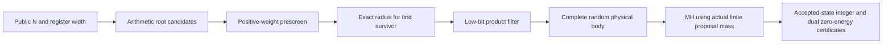

# 算法与适用范围

[English](method.md) | 简体中文（译文）

这是 GPU 软件实现。乘法器采用 compact sparse、carry_chain、Aadit 门罚项与单位 COPY；
只固定目标乘积和 structural-zero 端口。因子答案不进入初始化、候选支持或调度。
基础来源见[Camsari 等](experiment-report.zh-CN.md#ref-2017-camsari-stochastic-p-bits-invertible-logic)、
[Aadit 等及补充材料](experiment-report.zh-CN.md#ref-2022-aadit-sparse-ising-machines)与
[Lucas 的模型综述](experiment-report.zh-CN.md#ref-2014-lucas-ising-formulations-of-many-np-problems)。

能量约定为

$$H(s)=C-\sum_i h_i s_i-\sum_{i<j}J_{ij}s_i s_j,$$

其中 $s_i=2x_i-1$。固定 product 后精确保留能量常数。n×n 寄存器具有
$8n^2-5n$ 个完整 spins、$8n(n-1)$ 个自由 spins；目标整数位宽与物理变量数不同。

下图对应112／120／128乘积位使用的延迟开方路线。

64-bit 配置沿用筛选商提案；80-bit 使用 CRT/Fermat；96-bit 使用四字 CRT；
112/120/128-bit 使用延迟开方。它们是不同提案核，报告不能将混合配置曲线解释为
同一固定算法的复杂度。完整参数以冻结 JSON 为准。

高位宽路线通过公开 $N$ 建立 CRT 平方剩余必要条件。延迟开方先以额外 24 个小质数
预筛全部候选，仅对首个通过者计算精确半径；随后独立检查低24位乘积。每副本
K=262144，每候选8个 uint32 词，全部词始终消费。空候选、全库失败及后筛拒绝保留整态。

将完整状态写为 $y=(y_r,y_b)$，其中 $y_r$ 为因子寄存器 root，$y_b$ 为电路 body。
令 $Q_*(r)$ 为非空 root 的实际质量，缺失质量属于空候选。预筛以
$u(r)=1$ 或 $2^{-27}$ 的概率通过，独立乘积后筛以 $v(r)=1$ 或 $2^{-24}$ 的概率通过。
定义 $Z_{pre}=\sum_r Q_*(r)u(r)$ 与 $S_K(Z)=\sum_{j=0}^{K-1}(1-Z)^j$。
body 分布 $h_\beta(y_b\mid y_r)$ 采用实现中的整数 CDF 概率。
只对首个预筛通过者做后筛，后筛拒绝不会继续尝试下一个候选。非对角完整提案为

$$q_K(y\mid x)=S_K(Z_{pre})Q_*(y_r)u(y_r)v(y_r)h_\beta(y_b\mid y_r).$$

状态无关的 $S_K$ 在 MH 正反比中抵消，重合分支的边际质量相加；body 使用实际整数
CDF 质量。完整支持、平衡关系和小模型正确性不等于大模型混合快或存在经典速度优势。

固定 beta=12，无 PT。root 提案独立于物理态，因此单列同随机流的 selected-root 整数
对照。它省略 body/MH，但保留所有原噪声请求，只解释所选候选的贡献；不是完整库扫描
或经过专门优化的经典分解器。YAFU 另作端到端 CPU 参照，两种成功标准分开报告。

当前大位宽实现要求公开 $N\ge3(2^n-1)^2/4$，其中 n 为因子寄存器位宽。
正式面板更窄：$N/2^{2n}\in[0.75,0.875)$，两个不同的 n-bit 素数，最小相对间距0.1。
这不是任意整数接口，也不覆盖所有平衡半素数；实例生成分层及所有拒绝保留在内部来源记录。

## 方法出处

| 内容 | 主要来源 |
|---|---|
| 接受规则、正反支持与对角质量 | [Metropolis](experiment-report.zh-CN.md#ref-1953-metropolis)、[Hastings](experiment-report.zh-CN.md#ref-1970-hastings)、[Tierney](experiment-report.zh-CN.md#ref-1998-tierney-metropolis-hastings-kernels) |
| 有限信息提案与离散引导 | [Zanella](experiment-report.zh-CN.md#ref-2020-zanella-locally-balanced-proposals)、[Grathwohl 等](experiment-report.zh-CN.md#ref-2021-grathwohl-gwg) |
| 条件树、构造式body与前瞻比较 | [Hamze/de Freitas](experiment-report.zh-CN.md#ref-2004-hamze-trees)、[Siepmann/Frenkel](experiment-report.zh-CN.md#ref-1992-siepmann-frenkel)、[Naesseth 等](experiment-report.zh-CN.md#ref-2014-naesseth-smc) |
| 平方差、CRT和模筛 | [Erra/Grenier](experiment-report.zh-CN.md#ref-2009-erra-fermat-revisited)、[Blake](experiment-report.zh-CN.md#ref-2023-blake-fermat-machine-learning)、[Hittmeir](experiment-report.zh-CN.md#ref-2022-hittmeir-factorization-subset-sum) |
| 按颜色更新与调度 | [Gonzalez 等](experiment-report.zh-CN.md#ref-2011-gonzalez-parallel-gibbs-sampling)、[Brélaz](experiment-report.zh-CN.md#ref-1979-brelaz) |
| 温度交换的研究背景 | [Hukushima/Nemoto](experiment-report.zh-CN.md#ref-1996-hukushima-nemoto)、[Katzgraber 等](experiment-report.zh-CN.md#ref-2006-katzgraber-feedback-optimized-parallel-tempering) |
| 独立经典控制与复杂度边界 | [YAFU](experiment-report.zh-CN.md#ref-project-bbuhrow-yafu)、[Pollard](experiment-report.zh-CN.md#ref-1975-pollard-rho-factorization)、[Brent](experiment-report.zh-CN.md#ref-1980-brent-monte-carlo-factorization)、[Stevenhagen](experiment-report.zh-CN.md#ref-2008-stevenhagen-number-field-sieve) |

这些引文提供原理或比较背景；本项目的具体概率核、有限精度、更新顺序与证书仍由本页和源码定义。
完整研究出处见[引用附录](experiment-report.zh-CN.md#references)，包括未采用方向、代码比较和仅有摘要的来源。
CRT和平方差具有经典先例；需评价的内容是具体组合、完整成本、严格物理态认证与跨目标复用。
