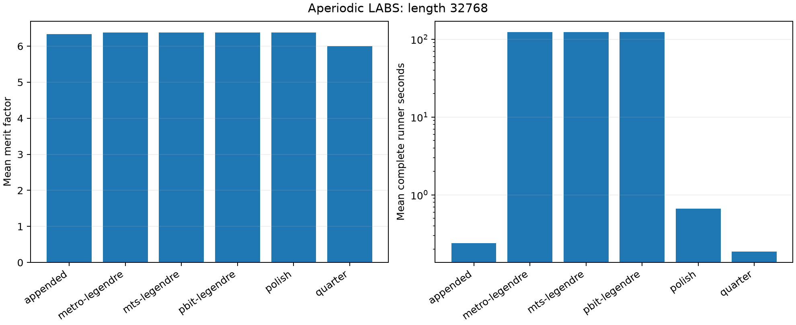

# RTX 5090原生高阶LABS

[English](experiment-report.md) | 简体中文

冻结L2包含**20次自然调用及四次工作量回放**，覆盖构造／修整归因及最高32768长度。
对$s_i\in\{-1,1\}$，非周期相关为$C_k=\sum_{i=0}^{N-k-1}s_i s_{i+k}$，
能量$E=\sum_{k=1}^{N-1}C_k^2$，merit factor为$N^2/(2E)$。

NVIDIA GeForce RTX 5090 (32607 MiB); AMD Eng Sample: 100-000001537-04 (quota 17.56 vCPU); Python 3.14.6; PyTorch 2.13.0+cu130; CUDA 13.0; driver 580.178.04.

本轮设备确认复用此前已测的长度和种子。

| 变体，长度32768 | 调用数 | 平均能量 | 平均merit factor | 平均完整runner秒 |
|---|---:|---:|---:|---:|
| appended | 1 | 84715248.000 | 6.337359 | 0.241 |
| metro-legendre | 2 | 84226446.000 | 6.374137 | 123.121 |
| mts-legendre | 2 | 84226508.000 | 6.374132 | 123.043 |
| pbit-legendre | 2 | 84226210.000 | 6.374155 | 123.171 |
| polish | 1 | 84226824.000 | 6.374108 | 0.667 |
| quarter | 1 | 89514508.000 | 5.997585 | 0.187 |

这些调用中的最好观察能量为**84226192**，不是最优性证书。
贪心修整在完整runner时间0.667秒内达到84226824；
相对它的最好能量改善为0.000750%，而随机／memetic调用约需123.112秒。
这点质量改善不构成一般实用时间／质量优势。
构造、贪心下降、随机修整及项目实现的GPU memetic-tabu分别归因。
后者不是作者CUDA程序，未完成的代数继续在数据中明确保留。
热浴和Metropolis使用16条轨迹，构造／贪心对照使用一条序列，memetic种群大小为100。

原生随机更新使用32768原变量，无辅助p-bit；高阶算术和缓存另计资源，
不能等同于32768个只有二次耦合的硬件位置。同一长度的多个种子不是不同LABS实例。
精确整数／XOR及独立整数变换核验全部保存序列；merit factor和局部收敛均不证明全局最优或量子优势。

[方法](README.zh-CN.md) · [核心数据](../../data/labs/rtx5090/calls.json) ·
[核验](../../data/labs/rtx5090/verification.json) · [复现](../reproduction.zh-CN.md)

## 参考来源与软件

下列入口保留研究中使用的背景及未实施对照。引用不表示复现；
方法说明中的版本与获取边界继续适用，本次发布没有重新进行一次全文文献审查。

- R1: [https://github.com/borkob/git_labs](https://github.com/borkob/git_labs)
- R2: [CSPLib prob005](https://www.csplib.org/Problems/prob005/)
- R3: [GPU memetic tabu v2](https://arxiv.org/abs/2504.00987v2)
- R4: [https://arxiv.org/html/2504.00987v2](https://arxiv.org/html/2504.00987v2)
- R5: [https://doi.org/10.1016/j.asoc.2009.03.005](https://doi.org/10.1016/j.asoc.2009.03.005)
- R6: [https://arxiv.org/abs/1406.5301](https://arxiv.org/abs/1406.5301)
- R7: [Advances in the merit factor problem for binary sequences v2](https://arxiv.org/abs/1205.0626v2)
- R8: [https://arxiv.org/html/1205.0626](https://arxiv.org/html/1205.0626)
- R9: [Dual-step optimization](https://doi.org/10.1016/j.dsp.2025.105316)
- R10: [https://arxiv.org/html/2409.07222v1](https://arxiv.org/html/2409.07222v1)
- R11: [https://arxiv.org/abs/2610.14361v1](https://arxiv.org/abs/2610.14361v1)
- R12: [https://arxiv.org/html/2610.14361v1](https://arxiv.org/html/2610.14361v1)
- R13: [https://arxiv.org/abs/2308.02342v2](https://arxiv.org/abs/2308.02342v2)
- R14: [PCE LABS v2](https://arxiv.org/abs/2506.17391v2)
- R15: [https://github.com/J-Brest/LABS](https://github.com/J-Brest/LABS)
- S1: [Python](https://www.python.org/)
- S2: [NumPy](https://numpy.org/)
- S3: [PyTorch](https://pytorch.org/)
- S4: [Triton](https://github.com/triton-lang/triton)
- S5: [CUDA](https://docs.nvidia.com/cuda/)
- S6: [SciPy](https://scipy.org/)
- S7: [Matplotlib](https://matplotlib.org/)
- S8: [PyYAML](https://pyyaml.org/)
- S9: [uv](https://docs.astral.sh/uv/)
- S10: [GCC](https://gcc.gnu.org/)
- S11: [pytest](https://docs.pytest.org/)
- S12: [Ruff](https://docs.astral.sh/ruff/)
