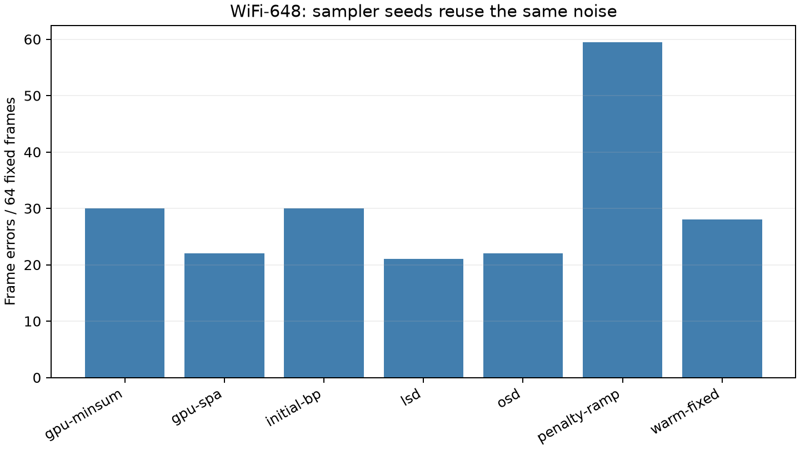

# RTX 5090 LDPC syndrome-likelihood search

English | [简体中文](experiment-report.zh-CN.md)

The frozen D2 panel has **41 natural calls, six work replays, five codes, and
96 unique channel frames**. It includes 64 WiFi-648 frames and eight frames per
large code. Repeated sampler seeds reuse those frames and do not double the
independent channel denominator.

NVIDIA GeForce RTX 5090 (32607 MiB); AMD Eng Sample: 100-000001537-04 (quota 17.56 vCPU); Python 3.14.6; PyTorch 2.13.0+cu130; CUDA 13.0; driver 580.178.04.

This device confirmation reuses previously measured codes, channel frames, and sampler seeds.
Frame errors count disagreement with the transmitted word. Physical-model
feasibility, including auxiliary constraints, is checked separately. Stochastic
calls use four replicas per frame, with frozen `max_steps` of 4096 for WiFi,
5632 for large native codes and 6144 for quadratic codes, plus a 600-second
time guard. These are fixed-work horizons, not identical time budgets for all
decoders. OSD is measured only on WiFi-648; its result does not establish
scalability to the large codes.

| Case | Variant | Calls | Valid frames, range | Frame errors, range | Frames per call | Mean runner + initialization (s) |
|---|---|---:|---:|---:|---:|---:|
| native32k-a-esm1 | gpu-minsum | 1 | 8 | 0 | 8 | 1.194 |
| native32k-a-esm1 | gpu-spa | 1 | 8 | 0 | 8 | 0.803 |
| native32k-a-esm1 | initial-bp | 1 | 8 | 0 | 8 | 0.805 |
| native32k-a-esm1 | lsd | 1 | 8 | 0 | 8 | 0.854 |
| native32k-a-esm1 | penalty-ramp | 2 | 4..6 | 2..4 | 8 | 3.944 |
| native32k-a-esm1 | warm-fixed | 2 | 8 | 0 | 8 | 3.697 |
| native32k-b-esm1 | gpu-minsum | 1 | 8 | 0 | 8 | 1.239 |
| native32k-b-esm1 | gpu-spa | 1 | 8 | 0 | 8 | 0.796 |
| native32k-b-esm1 | initial-bp | 1 | 8 | 0 | 8 | 0.809 |
| native32k-b-esm1 | lsd | 1 | 8 | 0 | 8 | 0.851 |
| native32k-b-esm1 | penalty-ramp | 2 | 3..4 | 4..5 | 8 | 3.944 |
| native32k-b-esm1 | warm-fixed | 2 | 8 | 0 | 8 | 3.687 |
| quadratic16k-a-esm1 | gpu-minsum | 1 | 8 | 0 | 8 | 0.946 |
| quadratic16k-a-esm1 | gpu-spa | 1 | 8 | 0 | 8 | 0.620 |
| quadratic16k-a-esm1 | initial-bp | 1 | 8 | 0 | 8 | 0.514 |
| quadratic16k-a-esm1 | lsd | 1 | 8 | 0 | 8 | 0.520 |
| quadratic16k-a-esm1 | quad-pair-ramp | 2 | 0 | 8 | 8 | 4.600 |
| quadratic16k-a-esm1 | quad-pair-ramp-warm | 2 | 8 | 0 | 8 | 4.124 |
| quadratic16k-b-esm1 | gpu-minsum | 1 | 8 | 0 | 8 | 0.951 |
| quadratic16k-b-esm1 | gpu-spa | 1 | 8 | 0 | 8 | 0.706 |
| quadratic16k-b-esm1 | initial-bp | 1 | 8 | 0 | 8 | 0.506 |
| quadratic16k-b-esm1 | lsd | 1 | 8 | 0 | 8 | 0.553 |
| quadratic16k-b-esm1 | quad-pair-ramp | 2 | 0 | 8 | 8 | 4.595 |
| quadratic16k-b-esm1 | quad-pair-ramp-warm | 2 | 8 | 0 | 8 | 4.123 |
| wifi648-heldout-esm2 | gpu-minsum | 1 | 34 | 30 | 64 | 0.827 |
| wifi648-heldout-esm2 | gpu-spa | 1 | 42 | 22 | 64 | 0.537 |
| wifi648-heldout-esm2 | initial-bp | 1 | 34 | 30 | 64 | 0.344 |
| wifi648-heldout-esm2 | lsd | 1 | 64 | 21 | 64 | 0.659 |
| wifi648-heldout-esm2 | osd | 1 | 64 | 22 | 64 | 6.806 |
| wifi648-heldout-esm2 | penalty-ramp | 2 | 3..6 | 58..61 | 64 | 2.452 |
| wifi648-heldout-esm2 | warm-fixed | 2 | 36 | 28 | 64 | 2.431 |

The receiver minimizes $\sum_i q_i e_i$ subject to $He=\sigma$, with
$q_i=\operatorname{round}(256\min(|LLR_i|,32))$. It receives no signed LLR,
hard-decision vector, or transmitted truth. Evaluation-only arrays are published
separately. The channel axis is $E_s/N_0$, not an inferred $E_b/N_0$.

The large native models use 32766 data p-bits and no auxiliaries. Full quadratic
models use 16380 data plus 16380 auxiliary p-bits, total 32760. These fixed-physical-budget
panels have different original code lengths, so their comparison is not a
same-code causal encoding experiment. Warm calls retaining all initial physical
best states: **8/10**.

Feasibility, likelihood, and decoding accuracy are distinct; an exact ML decision
can differ from the transmitted word. Only actually feasible states compete on
likelihood. Finite penalties do not prove global constrained-ML equivalence.
Compared with LSD on mutually feasible frames, stochastic calls found lower quantized
cost in **0** of 162 mutually feasible paired frame-attempts; repeated seeds reuse the same
channel frames. No global large-code ML or rare-error guarantee follows.

[Method](README.md) · [Core data](../../data/ldpc/rtx5090/calls.json) ·
[Verification](../../data/ldpc/rtx5090/verification.json) · [Reproduction](../reproduction.md)

## References and software

The linked inventory includes background and excluded comparisons used during the
research. Citation does not imply replication. Version/access limits in the method
guide remain applicable; this release did not perform a new full-text literature review.

- R1: [Error-Rate Reduction in LDPC Decoding via Bit-Aligned Temporal Reinforcement in Parallel Probabilistic-Bit Dynamics](https://arxiv.org/html/2609.12389v1)
- R2: [https://github.com/nonizawa/pSA_LDPC/blob/99bde4cd173ce90bdde098873925589fb9d4a05d/README.md](https://github.com/nonizawa/pSA_LDPC/blob/99bde4cd173ce90bdde098873925589fb9d4a05d/README.md)
- R3: [quantumgizmos/ldpc](https://github.com/quantumgizmos/ldpc)
- R4: [Localized statistics decoding for quantum low-density parity-check codes](https://arxiv.org/abs/2406.18655)
- R5: [Tavildar LDPC](https://github.com/tavildar/LDPC)
- S1: [Python](https://www.python.org/)
- S2: [NumPy](https://numpy.org/)
- S3: [PyTorch](https://pytorch.org/)
- S4: [Triton](https://github.com/triton-lang/triton)
- S5: [CUDA](https://docs.nvidia.com/cuda/)
- S6: [SciPy](https://scipy.org/)
- S7: [Matplotlib](https://matplotlib.org/)
- S8: [PyYAML](https://pyyaml.org/)
- S9: [uv](https://docs.astral.sh/uv/)
- S10: [GCC](https://gcc.gnu.org/)
- S11: [pytest](https://docs.pytest.org/)
- S12: [Ruff](https://docs.astral.sh/ruff/)
