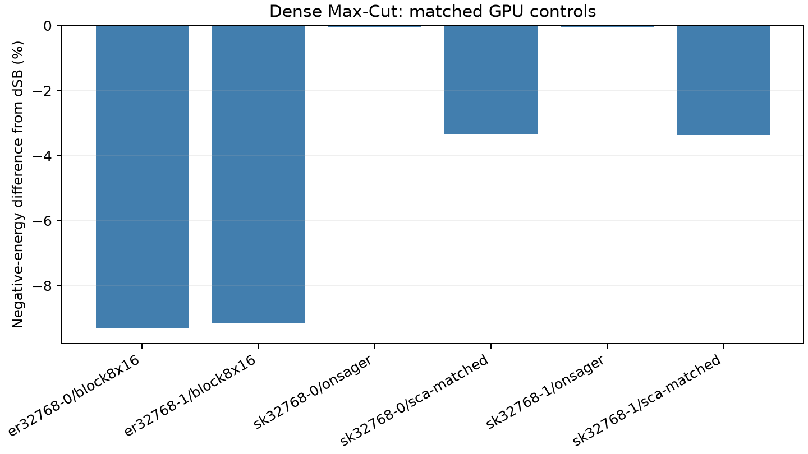

# RTX 5090稀疏与稠密Max-Cut

[English](experiment-report.md) | 简体中文

稀疏C1包含**110次自然调用及五次工作量回放**；稠密C3包含**20次自然调用及五次工作量回放**。
后者使用四张完整32768变量图、两个种子、16条轨迹及90秒搜索窗口。
实例及参数均在本次设备确认之前冻结。

NVIDIA GeForce RTX 5090 (32607 MiB); AMD Eng Sample: 100-000001537-04 (quota 17.56 vCPU); Python 3.14.6; PyTorch 2.13.0+cu130; CUDA 13.0; driver 580.178.04.

本轮设备确认复用此前已测的实例和种子。

## 稀疏面板

| 实例 | 方法 | 调用数 | 平均割值 | 平均完整runner秒 |
|---|---|---:|---:|---:|
| G1 | BURER2002 | 2 | 11624.000 | 10.188 |
| G1 | FESTA2002VNS | 2 | 11604.000 | 10.219 |
| G1 | metropolis-anneal | 2 | 11624.000 | 10.351 |
| G1 | pbit-anneal | 2 | 11624.000 | 10.380 |
| G1 | pbit-pt | 2 | 11622.500 | 10.354 |
| G22 | BURER2002 | 2 | 13346.000 | 10.164 |
| G22 | FESTA2002VNS | 2 | 13216.000 | 10.225 |
| G22 | metropolis-anneal | 2 | 13356.500 | 10.358 |
| G22 | pbit-anneal | 2 | 13353.000 | 10.396 |
| G22 | pbit-pt | 2 | 13319.500 | 10.360 |
| G55 | BURER2002 | 2 | 10244.500 | 15.155 |
| G55 | FESTA2002VNS | 2 | 10028.500 | 15.239 |
| G55 | metropolis-anneal | 2 | 10257.000 | 15.321 |
| G55 | pbit-anneal | 2 | 10242.000 | 15.392 |
| G55 | pbit-pt | 2 | 10256.500 | 15.353 |
| G81 | BURER2002 | 2 | 13754.000 | 15.254 |
| G81 | FESTA2002VNS | 2 | 12903.000 | 15.372 |
| G81 | metropolis-anneal | 2 | 13863.000 | 15.523 |
| G81 | pbit-anneal | 2 | 13791.000 | 15.556 |
| G81 | pbit-pt | 2 | 13949.000 | 15.506 |
| n32768-positive-i0 | BURER2002 | 2 | 566440.500 | 15.519 |
| n32768-positive-i0 | FESTA2002VNS | 2 | 554322.000 | 15.539 |
| n32768-positive-i0 | metropolis-anneal | 2 | 566727.500 | 15.863 |
| n32768-positive-i0 | pbit-anneal | 2 | 565672.000 | 15.898 |
| n32768-positive-i0 | pbit-pt | 2 | 566608.000 | 15.852 |
| n32768-positive-i1 | BURER2002 | 2 | 565657.000 | 15.460 |
| n32768-positive-i1 | FESTA2002VNS | 2 | 553607.000 | 15.705 |
| n32768-positive-i1 | metropolis-anneal | 2 | 565373.500 | 15.937 |
| n32768-positive-i1 | pbit-anneal | 2 | 564360.000 | 15.894 |
| n32768-positive-i1 | pbit-pt | 2 | 565602.500 | 15.869 |
| n32768-signed-i0 | BURER2002 | 2 | 206084.000 | 15.508 |
| n32768-signed-i0 | FESTA2002VNS | 2 | 194749.000 | 15.567 |
| n32768-signed-i0 | metropolis-anneal | 2 | 206524.500 | 15.892 |
| n32768-signed-i0 | pbit-anneal | 2 | 205533.000 | 15.940 |
| n32768-signed-i0 | pbit-pt | 2 | 206642.000 | 15.896 |
| n32768-signed-i1 | BURER2002 | 2 | 206365.500 | 15.494 |
| n32768-signed-i1 | FESTA2002VNS | 2 | 194145.500 | 15.566 |
| n32768-signed-i1 | metropolis-anneal | 2 | 206406.000 | 15.912 |
| n32768-signed-i1 | pbit-anneal | 2 | 205318.500 | 15.963 |
| n32768-signed-i1 | pbit-pt | 2 | 206223.500 | 15.893 |

表中列出32K和Gset，较小的正确性／开发算例继续保留在完整数据中。
名义图规模与目标活跃顶点数分开记账。稀疏GPU方法使用16条轨迹，CPU参考为单进程，
并行资源并不相同。主要CPU对照为未修改的BURER2002；
FESTA2002VNS包含已披露的符号／布尔修正，仍保留访问顺序限制。
经典对照不计作p-bit更新。
在32K图中，单位热浴平均割值严格高于BURER2002的图数为
0/4；其他变体的有限逐图结果保留在表中。

## 稠密面板

| 实例 | 变体 | 调用数 | 平均负能量 | 相对同GPU dSB变化 | 平均完整runner秒 |
|---|---|---:|---:|---:|---:|
| er32768-0 | block8x16 | 2 | 1997011.000 | -9.315% | 123.302 |
| er32768-0 | dsb0125 | 2 | 2202141.000 | 0.000% | 121.684 |
| er32768-1 | block8x16 | 2 | 1998270.000 | -9.142% | 121.028 |
| er32768-1 | dsb0125 | 2 | 2199335.000 | 0.000% | 121.683 |
| sk32768-0 | dsb100 | 2 | 4503404.000 | 0.000% | 124.179 |
| sk32768-0 | onsager | 2 | 4501345.000 | -0.046% | 124.884 |
| sk32768-0 | sca-matched | 2 | 4352836.000 | -3.343% | 132.274 |
| sk32768-1 | dsb100 | 2 | 4505052.000 | 0.000% | 122.963 |
| sk32768-1 | onsager | 2 | 4502982.000 | -0.046% | 125.673 |
| sk32768-1 | sca-matched | 2 | 4354314.000 | -3.346% | 124.173 |

负能量为$2C-\sum w$；只报告正权图原始割值会掩盖相对优化差异。
dSB是p-bit数为零的连续经典对照；SCA／Onsager为同步启发式，
与精确条件块Gibbs区分。稠密模型Torch分配峰值为4.546 GiB。

预设1%门要求在同一图族的两张图上均改善。本次图族判据为：**sk=false, er=false**。
没有追加32K CPU比较；即使跨过该门，也只作为有限同GPU观察，
不据此声称一般经典优势。大规模最优值仍未知。

[方法](README.zh-CN.md) · [稀疏数据](../../data/maxcut-sparse/rtx5090/calls.json) ·
[稠密数据](../../data/maxcut-dense/rtx5090/calls.json) · [复现](../reproduction.zh-CN.md)

## 参考来源与软件

下列入口保留研究中使用的背景及未实施对照。引用不表示复现；
方法说明中的版本与获取边界继续适用，本次发布没有重新进行一次全文文献审查。

- R1: [https://arxiv.org/abs/1805.05217](https://arxiv.org/abs/1805.05217)
- R2: [MQLib](https://github.com/MQLib/MQLib)
- R3: [https://web.stanford.edu/~yyye/yyye/Gset/](https://web.stanford.edu/~yyye/yyye/Gset/)
- R4: [https://www.nature.com/articles/s41598-025-90520-3](https://www.nature.com/articles/s41598-025-90520-3)
- R5: [https://github.com/nonizawa/GPU-pSAv](https://github.com/nonizawa/GPU-pSAv)
- R6: [Programmable Probabilistic Computer with 1,000,000 p-bits](https://arxiv.org/abs/2606.25313v1)
- R7: [Hardware Acceleration of Probabilistic Computing for Max-Cut Problems](https://ieeexplore.ieee.org/document/11668769/)
- R8: [High-performance combinatorial optimization based on classical mechanics](https://pmc.ncbi.nlm.nih.gov/articles/PMC11323291/)
- R9: [DOI](https://doi.org/10.1126/sciadv.abe7953)
- R10: [https://arxiv.org/abs/2610.13368v1](https://arxiv.org/abs/2610.13368v1)
- R11: [https://arxiv.org/html/2610.13368v1](https://arxiv.org/html/2610.13368v1)
- R12: [https://github.com/skethz/anechoic](https://github.com/skethz/anechoic)
- R13: [https://github.com/hariby/SA-complete-graph/tree/WK2000](https://github.com/hariby/SA-complete-graph/tree/WK2000)
- R14: [Edge-of-chaos enhanced quantum-inspired algorithm for combinatorial optimization](https://arxiv.org/abs/2508.17655)
- S1: [Python](https://www.python.org/)
- S2: [NumPy](https://numpy.org/)
- S3: [PyTorch](https://pytorch.org/)
- S4: [Triton](https://github.com/triton-lang/triton)
- S5: [CUDA](https://docs.nvidia.com/cuda/)
- S6: [SciPy](https://scipy.org/)
- S7: [Matplotlib](https://matplotlib.org/)
- S8: [PyYAML](https://pyyaml.org/)
- S9: [uv](https://docs.astral.sh/uv/)
- S10: [GCC](https://gcc.gnu.org/)
- S11: [pytest](https://docs.pytest.org/)
- S12: [Ruff](https://docs.astral.sh/ruff/)
