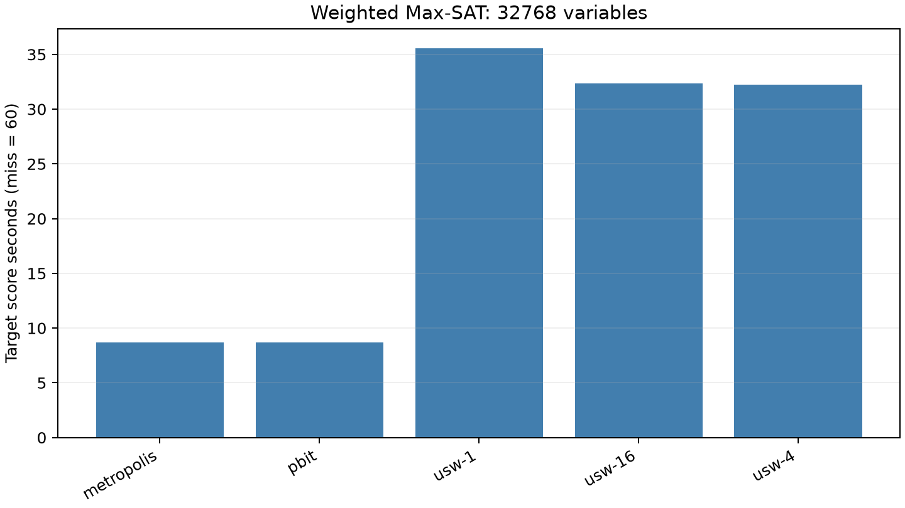

# RTX 5090加权Max-SAT目标研究

[English](experiment-report.md) | 简体中文

冻结X2面板包含**40次自然调用和五次工作量回放**，使用四个32768变量公式及两个种子。
全部为软子句，元数3、比例8、权重1–10。目标是在60秒内使未满足权重不高于26214，
其中预留2秒用于返回。GPU方法使用16条轨迹，同机CPU组合分别使用1／4／16进程。

NVIDIA GeForce RTX 5090 (32607 MiB); AMD Eng Sample: 100-000001537-04 (quota 17.56 vCPU); Python 3.14.6; PyTorch 2.13.0+cu130; CUDA 13.0; driver 580.178.04.

本轮设备确认复用此前已测的实例和种子。

| 方法 | 调用数 | 目标命中 | 平均目标时间分数（秒；未命中记60） | 平均完整runner秒 |
|---|---:|---:|---:|---:|
| metropolis | 8 | 8 | 8.690 | 8.785 |
| pbit | 8 | 8 | 8.683 | 8.777 |
| usw-1 | 8 | 8 | 35.585 | 35.624 |
| usw-16 | 8 | 8 | 32.327 | 32.544 |
| usw-4 | 8 | 8 | 32.225 | 32.355 |

p-bit与Metropolis的平均目标时间分数分别为8.683秒、8.690秒；
最快CPU组合的平均分数为p-bit的3.711倍，两种GPU方法数值接近。
目标分数包含runner准备与证书观察，源码恢复／进程启动耗时也保留在数据中。
不同停止和观测机制的成本计入各自实现。越过阈值后的更低成本，
不构成统一固定预算下解质量更好的证明。

证据只覆盖这一冻结随机软子句面板及质量目标，不证明普遍热浴优势、工业／硬子句性能、
硬件能效或相对最强同GPU求解器的优势。原始赋值和目标删失均保留计数。
USW-LS上游源码须由使用者自行取得；发布内容提供项目自有插桩工具，不授予原程序再分发许可。

[方法](README.zh-CN.md) · [核心数据](../../data/maxsat/rtx5090/calls.json) ·
[核验](../../data/maxsat/rtx5090/verification.json) · [复现](../reproduction.zh-CN.md)

## 参考来源与软件

下列入口保留研究中使用的背景及未实施对照。引用不表示复现；
方法说明中的版本与获取边界继续适用，本次发布没有重新进行一次全文文献审查。

- R1: [https://zenodo.org/records/21358014](https://zenodo.org/records/21358014)
- R2: [USW-LS](https://github.com/shaowei-cai-group/USW-LS)
- R3: [https://github.com/shaowei-cai-group/NuWLS](https://github.com/shaowei-cai-group/NuWLS)
- R4: [TT-Open-WBO-Inc](https://github.com/alexander-nadel-academic/tt-open-wbo-inc)
- R5: [https://arxiv.org/abs/2201.12858v1](https://arxiv.org/abs/2201.12858v1)
- S1: [Python](https://www.python.org/)
- S2: [NumPy](https://numpy.org/)
- S3: [PyTorch](https://pytorch.org/)
- S4: [Triton](https://github.com/triton-lang/triton)
- S5: [CUDA](https://docs.nvidia.com/cuda/)
- S6: [SciPy](https://scipy.org/)
- S7: [Matplotlib](https://matplotlib.org/)
- S8: [PyYAML](https://pyyaml.org/)
- S9: [uv](https://docs.astral.sh/uv/)
- S10: [GCC](https://gcc.gnu.org/)
- S11: [pytest](https://docs.pytest.org/)
- S12: [Ruff](https://docs.astral.sh/ruff/)
