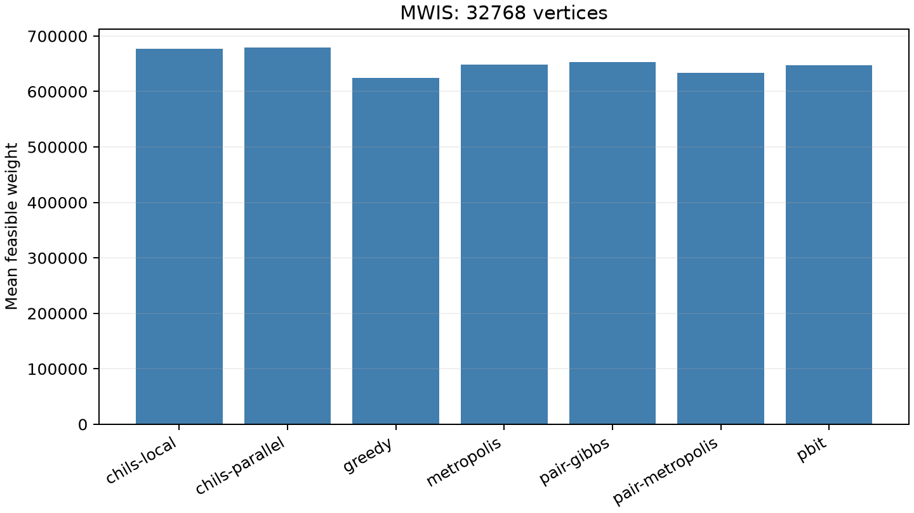

# RTX 5090加权独立集研究

[English](experiment-report.md) | 简体中文

冻结M2面板包含**78次自然调用和四次工作量回放**：两个2048顶点开发图、四个32768顶点确认图，
各用两个算法种子。平均度8，权重1–100；GPU方法使用16条轨迹，CHILS使用一个或四个CPU线程，对应种群大小1和16。
32768顶点的随机／CHILS调用采用12秒搜索上限，贪心完成即返回。
下表包含52次确认调用，另26次属于开发调用。本次设备确认没有新增未见实例。

NVIDIA GeForce RTX 5090 (32607 MiB); AMD Eng Sample: 100-000001537-04 (quota 17.56 vCPU); Python 3.14.6; PyTorch 2.13.0+cu130; CUDA 13.0; driver 580.178.04.

| 方法，32768顶点 | 调用数 | 平均可行权重 | 平均完整runner秒 |
|---|---:|---:|---:|
| chils-local | 8 | 676851.250 | 12.606 |
| chils-parallel | 8 | 679077.375 | 12.628 |
| greedy | 4 | 624714.750 | 0.599 |
| metropolis | 8 | 648611.625 | 14.958 |
| pair-gibbs | 8 | 653237.875 | 15.318 |
| pair-metropolis | 8 | 634040.750 | 15.356 |
| pbit | 8 | 647702.125 | 15.051 |

联合Gibbs的平均权重相对单位热浴变化0.855%，相对单线程CHILS变化-3.489%。
这是有限面板上的完整实现比较，不是一般MWIS排名。
正式试验前，CHILS按相同固定源码及原有`-march=native`选项在实际云端CPU上重新构建。

直接模型使用32768原变量，没有辅助p-bit。单位及联合两位更新沿用声明的惩罚和原始物理态口径，
全部保存态通过独立整数权重／冲突核验。经典对照的随机更新p-bit数为零，
其图变量数另行保留。当前最好解或CHILS返回值不等于最优性证明。

[方法](README.zh-CN.md) · [核心数据](../../data/mwis/rtx5090/calls.json) ·
[核验](../../data/mwis/rtx5090/verification.json) · [复现](../reproduction.zh-CN.md)

## 参考来源与软件

下列入口保留研究中使用的背景及未实施对照。引用不表示复现；
方法说明中的版本与获取边界继续适用，本次发布没有重新进行一次全文文献审查。

- R1: [KaMIS](https://github.com/KarlsruheMIS/KaMIS)
- R2: [CHILS](https://github.com/KarlsruheMIS/CHILS)
- R3: [https://arxiv.org/abs/2412.14198](https://arxiv.org/abs/2412.14198)
- R4: [https://drops.dagstuhl.de/storage/00lipics/lipics-vol338-sea2025/html/LIPIcs.SEA.2025.22/LIPIcs.SEA.2025.22.html](https://drops.dagstuhl.de/storage/00lipics/lipics-vol338-sea2025/html/LIPIcs.SEA.2025.22/LIPIcs.SEA.2025.22.html)
- R5: [https://arxiv.org/abs/2202.09372](https://arxiv.org/abs/2202.09372)
- R6: [https://arxiv.org/abs/1304.6666](https://arxiv.org/abs/1304.6666)
- S1: [Python](https://www.python.org/)
- S2: [NumPy](https://numpy.org/)
- S3: [PyTorch](https://pytorch.org/)
- S4: [Triton](https://github.com/triton-lang/triton)
- S5: [CUDA](https://docs.nvidia.com/cuda/)
- S6: [SciPy](https://scipy.org/)
- S7: [Matplotlib](https://matplotlib.org/)
- S8: [PyYAML](https://pyyaml.org/)
- S9: [uv](https://docs.astral.sh/uv/)
- S10: [GCC](https://gcc.gnu.org/)
- S11: [pytest](https://docs.pytest.org/)
- S12: [Ruff](https://docs.astral.sh/ruff/)
