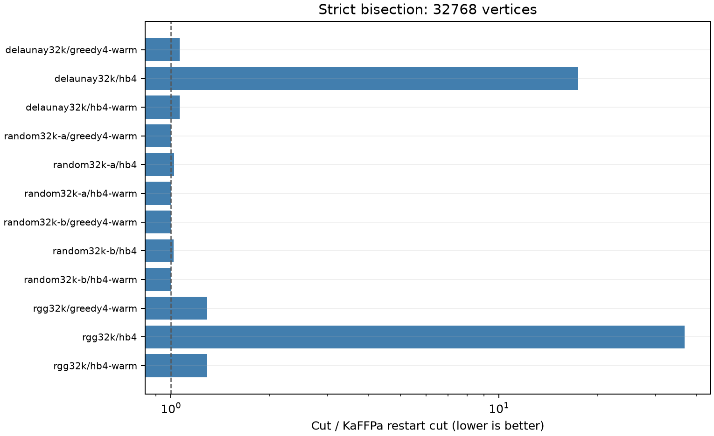

# RTX 5090 strictly balanced graph bisection

English | [简体中文](experiment-report.zh-CN.md)

The frozen P2 panel has **40 natural calls and five work replays** on four
32768-vertex graphs. The constraint is exactly half the vertices on each side,
with unit vertex weights and positive integer edge weights. Stochastic methods
use eight replicas and 45-second search windows. KaFFPa uses the strong preset,
zero imbalance, and final exact-balance enforcement.

NVIDIA GeForce RTX 5090 (32607 MiB); AMD Eng Sample: 100-000001537-04 (quota 17.56 vCPU); Python 3.14.6; PyTorch 2.13.0+cu130; CUDA 13.0; driver 580.178.04.

This device confirmation reuses previously measured graphs and seeds.

| Graph | Variant | Calls | Mean cut | Mean runner + recorded initialization (s) |
|---|---|---:|---:|---:|
| delaunay32k | greedy4-warm | 1 | 343.000 | 3.602 |
| delaunay32k | hb4 | 2 | 5615.500 | 127.956 |
| delaunay32k | hb4-warm | 2 | 343.000 | 48.498 |
| delaunay32k | initial | 1 | 343.000 | 0.642 |
| delaunay32k | kaffpa-restarts | 2 | 323.000 | 46.832 |
| delaunay32k | metro2 | 2 | 8494.000 | 128.606 |
| random32k-a | greedy4-warm | 1 | 109420.000 | 46.264 |
| random32k-a | hb4 | 2 | 111897.000 | 232.763 |
| random32k-a | hb4-warm | 2 | 109420.000 | 91.541 |
| random32k-a | initial | 1 | 109420.000 | 39.160 |
| random32k-a | kaffpa-restarts | 2 | 109420.000 | 107.716 |
| random32k-a | metro2 | 2 | 115939.500 | 254.177 |
| random32k-b | greedy4-warm | 1 | 109685.000 | 35.538 |
| random32k-b | hb4 | 2 | 111783.500 | 250.515 |
| random32k-b | hb4-warm | 2 | 109685.000 | 78.390 |
| random32k-b | initial | 1 | 109685.000 | 28.357 |
| random32k-b | kaffpa-restarts | 2 | 109567.000 | 81.629 |
| random32k-b | metro2 | 2 | 115902.000 | 247.315 |
| rgg32k | greedy4-warm | 1 | 234.000 | 4.727 |
| rgg32k | hb4 | 2 | 6708.500 | 198.576 |
| rgg32k | hb4-warm | 2 | 234.000 | 49.688 |
| rgg32k | initial | 1 | 234.000 | 0.879 |
| rgg32k | kaffpa-restarts | 2 | 182.000 | 46.896 |
| rgg32k | metro2 | 2 | 10340.500 | 186.561 |

Four-site heat bath has a lower mean cold-start cut than two-site Metropolis on
4/4 graphs and than KaFFPa restarts on
0/4 graphs. Block size and acceptance rule both
change in the first comparison, so it does not isolate a heat-bath effect.
The four-site warm refinements improve the shared initial cut in
0/12 calls, including deterministic refinement.

Native two-/four-site blocks preserve cardinality. Their banks are state independent,
same-color blocks do not share edges, and the union of exchanges is connected.
All saved partitions pass an independent integer XOR-cut and exact-balance check.
RGG isolates still participate in the global balance.

Cold optimization, inherited warm quality, and stochastic marginal improvement
are distinct. For warm runs, the table adds the separately measured common
initialization; it is a sum of recorded components, not a separately measured
communication latency. State export and certification are part of complete cost.
The panel does not prove optimal 32K cuts or a general advantage over multilevel
partitioners, GPU partitioners, multiway methods, or hypergraph methods.

[Method](README.md) · [Core data](../../data/partition/rtx5090/calls.json) ·
[Verification](../../data/partition/rtx5090/verification.json) · [Reproduction](../reproduction.md)

## References and software

The linked inventory includes background and excluded comparisons used during the
research. Citation does not imply replication. Version/access limits in the method
guide remain applicable; this release did not perform a new full-text literature review.

- R1: [Restoring Sparsity in Potts Machines via Mean-Field Constraints](https://arxiv.org/html/2602.04200v2)
- R2: [https://doi.org/10.1038/s44335-026-00097-x](https://doi.org/10.1038/s44335-026-00097-x)
- R3: [Think Locally, Act Globally: Perfectly Balanced Graph Partitioning](https://arxiv.org/abs/1210.0477)
- R4: [https://github.com/KaHIP/KaHIP](https://github.com/KaHIP/KaHIP)
- R5: [Walshaw Graph Partitioning Archive](https://chriswalshaw.co.uk/partition/)
- R6: [Quantum Annealing for Minimum Bisection Problem: A Machine Learning-based Approach for Penalty Parameter Tuning](https://arxiv.org/abs/2509.19005)
- S1: [Python](https://www.python.org/)
- S2: [NumPy](https://numpy.org/)
- S3: [PyTorch](https://pytorch.org/)
- S4: [Triton](https://github.com/triton-lang/triton)
- S5: [CUDA](https://docs.nvidia.com/cuda/)
- S6: [SciPy](https://scipy.org/)
- S7: [Matplotlib](https://matplotlib.org/)
- S8: [PyYAML](https://pyyaml.org/)
- S9: [uv](https://docs.astral.sh/uv/)
- S10: [GCC](https://gcc.gnu.org/)
- S11: [pytest](https://docs.pytest.org/)
- S12: [Ruff](https://docs.astral.sh/ruff/)
