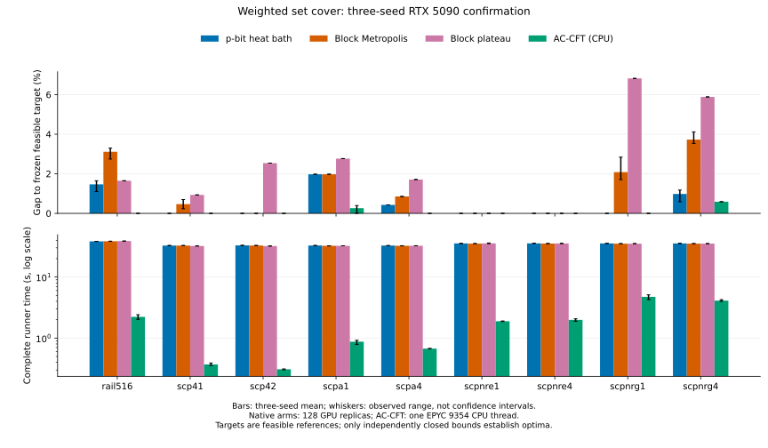

# 保持可行性的 p-bit 加权集合覆盖搜索

[English](report.md) · [概览](README.zh-CN.md) · [源码指南](source-guide.zh-CN.md)

## 验收结果与范围

冻结的 SC8 RTX 5090 确认面板包含 **117 次自然调用和四次工作回放**。热浴在 **27/27** 次调用中改善共同贪心前缀，在 **15/27** 次中达到冻结质量目标。按原始整数费用，热浴有 15 次优于匹配 Metropolis、19 次优于允许中性移动的下降，本面板中对两者均无败绩。AC-CFT 仍更强：热浴 16 次同费用、11 次更差、没有胜出。这些结果支持这一特定块搜索流程在有限预算内的增量改进，不能证明相对专门经典求解器的普遍速度或质量优势。

问题限定为正整数成本的静态加权集合覆盖：

$$\min_{x\in\{0,1\}^n}c^Tx\quad\text{subject to}\quad Ax\ge\mathbf1.$$

每个原始列对应一个二元决策。九份输入均来自 [OR-Library](https://people.brunel.ac.uk/~mastjjb/jeb/orlib/scpinfo.html)；基准清单固定原始数值文件身份，并区分按行存储的 SCP 和按列存储的铁路数据。完整 `rail516` 模型包含 516 个必覆行、47,311 列，没有填充或列约简。副本数与单模型规模分开报告。GPU 模拟联合更新不意味着相同数量的已制造器件，也不等于已经完成纯二体硬件嵌入。

## 混合方法与归因

确定性的“费用／新增覆盖行数”贪心构造及冗余列删除，提供可行的经典前缀。128 个副本均从这个覆盖开始。仅依赖输入的 `cost-minhash` 分组建立 16 组八位块库：共享低随机秩覆盖行的列相邻，随后按费用与固定随机并列规则排列。每列在每组块库中恰出现一次；第一组提供完整随机分区。

选定块 $B$ 后固定块外变量。内核枚举至多 $2^8$ 个局部二元模式，以原始行覆盖约束排除不可行模式，并用子集 zeta 变换从行掩码计算未覆盖行。若块总数为 $L$、块库组数为 $D$、$\epsilon=0.0625$，活动列选块概率为

$$g(B\mid x)=\frac{\epsilon+|x_B|}{\epsilon L+D|x|}.$$

热浴条件分布包含依赖状态的选块因子：

$$P(z\mid x_{\bar B},B)\propto\mathbf1[Ax\ge\mathbf1]\exp(-\beta c_B^Tz)g(B\mid x_{\bar B},z).$$

固定温度下，这是扩展分布 $\pi(x)g(B\mid x)$ 的条件更新。实际有限时间退火属于优化实验，不由此宣称达到平衡分布或给出混合时间保证。温度采用原始费用的倒数单位。选定温程为 SCP41/SCP42 在 64 扫循环内 0.2→8；六个 3K/5K/10K SCP 实例恒定 4；RAIL516 恒定 16。

匹配 Metropolis 使用相同表示、前缀、块库、温度、副本数和活动选块，并在接受概率中加入选块概率比校正。Plateau 对照从费用最低的可行块模式中均匀采样，允许中性移动、禁止费用增加。其并列规则不同于热浴权重，因此它是归因对照，不是严格只改变单一参数的因果干预。两者均为经典对照：公开账本将其物理更新 p-bit 数记为零，即使它们使用二元数组并在 GPU 上执行。

AC-CFT 是独立的专业 CPU 参照，使用拉格朗日优化、列选择／固定及精修。我们构建 Francesco Cavaliere 的[固定实现](https://github.com/c4v4/cft/tree/6cb63d0036223b8be9c4d01f95b296d641209f95)，并非原论文作者发布的代码。上游搜索逻辑保留，明确记录的计时观测接口用于工作回放。[1999 年 CFT 论文](https://doi.org/10.1287/opre.47.5.730)提供算法背景，不移用其历史速度数据。LP/MILP 调用提供较长预算的界与整数见证，不属于等时 p-bit 竞争方法。

原生高阶覆盖模型已有先例。[Lucas（2014）§5.1](https://www.frontiersin.org/journals/physics/articles/10.3389/fphy.2014.00005/full)给出 QUBO 表示；[Searle 等（2026）§3.1 及附录 C.1](https://arxiv.org/html/2605.06037v1)讨论高阶命中集更新。它们是本研究使用的背景或未采用的替代路线：本面板没有平方松弛 QUBO 性能臂，也不使用专用硬件的投影计时。证据针对实测可行块流程及其对照，不据集合覆盖编码或热浴公式本身主张原创。

## 冻结评估与计时

完整分母为 $9\times3\times4+9=117$：九个实例 × 三枚种子 × 热浴／Metropolis／plateau／AC-CFT，另每实例一次 LP/MILP。117 个进程全部正常完成，没有隐去或未执行的调用。种子为 **2026102391、2026102392、2026102393**。三个原生方法每次使用 128 副本，AC-CFT 使用一个 CPU 工作线程。共享输入与前缀的副本不能被当作 128 个独立基准试验。

SCP41、SCPNRG1、RAIL516 参与本轮云端调参。其余六个确认实例未参加这轮调参，但更早研究已经接触过这些家族和实例。因此“留出”只相对于当前调参轮次，不表示历史上从未见过。SC8 开始前冻结参数，报告完整三种子面板，不用最佳种子替代完整分母。

原生搜索窗口为 30 s，安全上限为每副本 200,000,000 次块更新，每 256 次更新观测一次。只有在搜索期限内完成的观测才能更新质量见证。最后一个越过期限的块仍保留在证据中，但不能改善期限内得分。首次命中时间是观测时间，不是精确转移时刻。AC-CFT 使用名义 30 s 软时限，可提前结束或超时；返回见证与其实际完整耗时配对。LP/MILP 总时限为 60 s，其中 LP 至多 15 s。因此这不是匹配总时间或匹配硬件资源的竞赛。

实测 GPU 为 **NVIDIA GeForce RTX 5090**，报告设备显存 33,766,572,032 字节。CPU 对照运行于 **AMD EPYC 9354 32-Core Processor**，请求单线程并固定到一个逻辑 CPU。软件为 Python 3.14.6、PyTorch 2.13.0+cu130、CUDA build 13.0、Triton 3.7.1、NumPy 2.4.4、SciPy 1.18.0。[环境记录](../../data/set-cover/rtx5090/environment.json)和锁定源码分发定义复现版本。

`complete_runner_seconds` 包含运行器准备、贪心初始化、块构造、GPU 预热、采样、状态传回和最终认证。各子阶段耗时单独保存在 [calls.json](../../data/set-cover/rtx5090/calls.json)。源码恢复及外层进程启动不在该运行器计时内。Allocated/reserved 指 PyTorch CUDA 分配器，包含全部 128 副本及工作区，不包含整卡驱动与系统开销。

## 全部原始整数费用

每个方法单元格按上面的固定种子顺序列出三次结果，越低越好。`Target` 是预先声明的质量阈值；`LB` 是本面板中经独立核验的最强有理整数下界。两列都不能一概理解为文献全局最优值。

| 实例 | 列数 | 贪心前缀 | Target | LB | 热浴 | Metropolis | Plateau | AC-CFT |
|---|---:|---:|---:|---:|---|---|---|---|
| SCP41 | 1,000 | 434 | 429 | 429 | 429/429/429 | 432/430/431 | 433/433/433 | 429/429/429 |
| SCP42 | 1,000 | 529 | 512 | 512 | 512/512/512 | 512/512/512 | 525/525/525 | 512/512/512 |
| SCPA1 | 3,000 | 261 | 253 | 247 | 258/258/258 | 258/258/258 | 260/260/260 | 254/254/253 |
| SCPA4 | 3,000 | 242 | 234 | 232 | 235/235/235 | 236/236/236 | 238/238/238 | 234/234/234 |
| SCPNRE1 | 5,000 | 30 | 29 | 22 | 29/29/29 | 29/29/29 | 29/29/29 | 29/29/29 |
| SCPNRE4 | 5,000 | 32 | 28 | 22 | 28/28/28 | 28/28/28 | 28/28/28 | 28/28/28 |
| SCPNRG1 | 10,000 | 189 | 176 | 160 | 176/176/176 | 181/179/179 | 188/188/188 | 176/176/176 |
| SCPNRG4 | 10,000 | 181 | 170 | 149 | 172/171/172 | 177/176/176 | 180/180/180 | 171/171/171 |
| RAIL516 | 47,311 | 203 | 182 | 182 | 184/185/185 | 187/188/188 | 185/185/185 | 182/182/182 |

SCP41=429、SCP42=512、RAIL516=182 均有原始可行见证与精确有理下界闭合。热浴的全部种子达到前两个最优值，但三次均未达到 RAIL516 最优值。SCPA1/SCPA4 的 MILP 求解器在 253/234 处报告 gap 为零，而单独验证的有理 LP 下界仍为 247/232；仅凭后者不能闭合这两个最优性差距。

SCPNRG4 的冻结目标 170 来自更早的独立核验 AC-CFT 覆盖。[数学见证](../../data/set-cover/reference-witnesses/scpnrg4-target170.npz)保留，但不把旧计时混入本面板。本轮 AC-CFT 返回 171/171/171，所有方法均未达到 170。冻结目标不会事后改成 171，也不被称为已证明的文献最优值。

| 27 次配对自然调用的比较 | 热浴胜 | 平 | 负 |
|---|---:|---:|---:|
| 匹配 Metropolis | 15 | 12 | 0 |
| Plateau 下降 | 19 | 8 | 0 |
| AC-CFT | 0 | 16 | 11 |

27 次热浴调用全部改善贪心前缀；15 次目标命中中，没有一次继承初始化已经达到的目标。这些是九个选定实例上的调用级观察，不是经校准的成功概率或统计显著性结论。强对照、未命中和持平结果都留在同一账本内。

## 完整耗时与规模

图中为三种子均值及观察范围，不是置信区间。质量差距使用冻结目标，包括 SCPNRG4 的 170，不用本面板最好值替换。GPU 方法使用 128 副本，AC-CFT 使用一个 CPU 线程。

| 实例 | 热浴平均完整时间（s） | AC-CFT 平均完整时间（s） |
|---|---:|---:|
| SCP41 | 32.7624 | 0.3694 |
| SCP42 | 32.9265 | 0.3086 |
| SCPA1 | 32.7714 | 0.8729 |
| SCPA4 | 32.6987 | 0.6721 |
| SCPNRE1 | 35.4792 | 1.8862 |
| SCPNRE4 | 35.5609 | 1.9870 |
| SCPNRG1 | 35.4675 | 4.7314 |
| SCPNRG4 | 35.4691 | 4.1088 |
| RAIL516 | 38.3254 | 2.2234 |

最大模型每个热浴副本有 47,311 个模拟更新 p-bit、零辅助 p-bit，共 128 副本。RAIL516 峰值为 **228.638 MiB allocated / 236.000 MiB reserved**。热浴最好费用 184，比认证最优值 182 高两个单位。它证明流程能在这个自然模型规模上执行，不表示在 47,311 变量规模成功达到最优。AC-CFT 每枚种子均达到 182，完整耗时显著更低。

## 独立验证与复现边界

验收的完整原始审计覆盖自然调用与回放，共检查 **1,083,941 个已保存整数状态**。公开核心包含原始初态／终态／质量最好态／能量最好态、全部经典返回覆盖、有理对偶分子及明确说明的观测子集。保留每个副本的全部最好值改善、曲线两端和资格边界；中间当前态波动及周期性完整状态档案不在核心分发范围内。云端对全部 121 条公开记录核验了 **43,045 个保留状态见证**，另核验历史 SCPNRG4 的费用 170 见证，后者不在此计数内。公开核心 43,045 次与原始完整档案 1,083,941 次覆盖的保留范围不同，不得当作同一计数。

[独立验证器](../../scripts/set_cover/verify_release.py)仅导入标准库与 NumPy。它按 SHA-256 绑定输入和见证、解析原始关联文本、复算整数费用及每行覆盖、验证保留曲线索引和期限／固定工作量资格、检查精确有理对偶不等式，并拒绝不完整的调用清单。初始化目标命中与随机阶段后的新增命中分开统计。对行权重 $a_i/d$，以整数运算检查 $a_i\ge0$ 和 $\sum_{i:A_{ij}=1}a_i\le dc_j$，下界为 $\lceil\sum_i a_i/d\rceil$。

三次原生工作回放和一次 AC-CFT 回放检验原工作，不增加独立试验。原生回放冻结原运行的质量步数边界，墙钟观测可以不同。AC-CFT 的回放计时器是工作复现工具，不是新的性能测量。更换设备或软件栈重跑时，有限时间结果可能变化；不可改写的已发布证书仍可直接核验。输入恢复、独立检查、隔离新运行及 AC-CFT 重建命令见[源码指南](source-guide.zh-CN.md)。

## 参考资料

1. J. E. Beasley，[OR-Library 集合覆盖数据与格式说明](https://people.brunel.ac.uk/~mastjjb/jeb/orlib/scpinfo.html)。用于原始输入、规模和格式区别；基准清单固定所选文件身份。
2. A. Caprara、M. Fischetti、P. Toth，[A Heuristic Method for the Set Covering Problem](https://doi.org/10.1287/opre.47.5.730)，*Operations Research* 47(5), 730–743（1999）。核对出版者摘要及题录，不声称全文复现或历史速度比较。
3. F. Cavaliere，[AC-CFT 实现，提交 6cb63d0036223b8be9c4d01f95b296d641209f95](https://github.com/c4v4/cft/tree/6cb63d0036223b8be9c4d01f95b296d641209f95)。固定源码、README 与 MIT 许可；实现者不同于原论文作者。
4. A. Lucas，[Ising formulations of many NP problems](https://www.frontiersin.org/journals/physics/articles/10.3389/fphy.2014.00005/full)，*Frontiers in Physics* 2:5（2014），§5.1。QUBO／辅助变量背景，本轮没有 QUBO 性能复现。
5. A. J. Searle 等，[面向高阶、稠密连接或可重构组合优化问题的虚拟连接概率计算机](https://arxiv.org/html/2605.06037v1)，arXiv:2605.06037v1（2026 年 5 月 7 日），§3.1 及附录 C.1。高阶命中集先例；其硬件投影性能不进入本 GPU 比较。
6. [SciPy](https://scipy.org/) 1.18.0 及所带 [HiGHS](https://highs.dev/) 后端。LP/MILP 参照；数值求解器报告与精确有理证书分开。
7. [PyTorch](https://pytorch.org/) 2.13.0+cu130 与 [Triton](https://triton-lang.org/main/index.html) 3.7.1。GPU 状态存储、随机数与自定义内核。
8. [NumPy](https://numpy.org/) 2.4.4。输入处理和独立数组／证书核验。
9. [{fmt}](https://github.com/fmtlib/fmt/tree/10.2.1) 10.2.1。固定的 AC-CFT 构建依赖，单独获取并保留其许可证。
10. [uv](https://docs.astral.sh/uv/)。锁定项目环境与复现命令运行器；仓库锁文件定义依赖版本。
