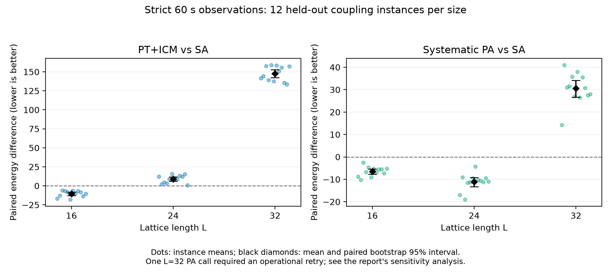
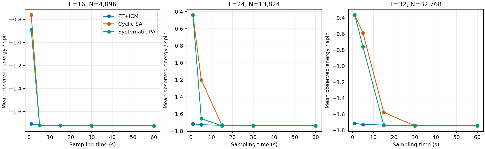

# 立方自旋玻璃优化的RTX 5090评测

[English](experiment-report.md) | 简体中文

实测日期：2026-10-19。本报告评价实现速度与限时组合优化，不研究物理动力学。证据支持
两个有限结论：v5相对v1降低了固定工作量的执行成本；方法排序随本面板的晶格规模而变化。
三种对照均是本项目实现，尚未建立对外部国际先进方法的优势。

## 模型与方法

最小化

$$H(s)=-\sum_{(i,j)\in E}J_{ij}s_i s_j,\qquad s_i,J_{ij}\in\{-1,+1\},$$

模型为完整开放立方晶格、零场、零常数项。$N=L^3$、$M=3L^2(L-1)$；坐标编号
$i=x+Ly+L^2z$。$L=32$对应32,768个逻辑自旋、95,232条唯一耦合边。
公开接口接受$2\le L\le32$，拒绝缺边、周期边界、嵌入、非单位权重和有场输入。
内部几何工具的能力不扩展本次实测范围。

PT使用双色热浴更新，$P(s_i=+1)=1/(1+e^{-2\beta h_i})$，交替相邻温度交换，以及
不一致团簇上的ICM移动。ICM保持配对状态的能量之和，不保持各自能量。本实现使用固定
几何温度梯度，不是自适应PT。SA使用双色Metropolis更新并循环温程。PA增加组内
systematic重采样，权重正比于$e^{-\Delta\beta E}$，周期之间独立重启人口；每次重采样
每组使用一个均匀偏移。谱系收缩和ESS诊断不能证明平衡或粒子独立。

v5融合局部场、概率表查询与自旋写回，结合分块整数能量归约；随机数采用FP64。
ICM包含CPU工作，其计算与传输计入完整采样区间。十四份运行时源码与实测版本逐字节相同，
见[来源记录](../../provenance/spin-glass/release-v1.json)。

## 硬件与冻结评测

单张NVIDIA GeForce RTX 5090，32,607 MiB显存，驱动615.71.09，计算能力12.0；
宿主CPU为AMD EPYC 9354，容器CPU配额约15.36核，Torch使用一个CPU线程。
环境为Python 3.14.6、Torch 2.13.0+cu130、CUDA 13.0、Triton 3.7.1。
allocated显存不包括全部驱动/上下文或分配器保留缓存。

[冻结面板](../../configs/spin-glass/s23-panel.json)包括42个随机耦合实例：$L=16,24,32$
各两个开发、十二个留出实例，另有安装/正确性样例。输入在调参前冻结，不筛选实例。
耦合使用NumPy PCG64，种子为`202610190000 + 1000 * length + instance_id`；
实际显式边文件是最终依据。

| 阶段 | 计划成功逻辑调用 | 评价内容 |
|---|---:|---|
| 预检 | 16 | 小例、同设备回放及v1/v5固定工作量对照 |
| 校准 | 36 | 两个开发实例，每方法/规模两个候选，60秒 |
| 确认 | 216 | 十二个留出实例、两seed、三种冻结方法，60秒 |
| 完整起点回放 | 3 | 每方法一条指定32³原轨迹 |

校准seed为2026101901；确认seed为2026101902和2026101903；固定工作量seed为
2026101904和2026101905；小例seed为2026101906。仅按开发实例选择：先比较实例平均
能量，再比较最差实例均值，最后按候选顺序。完整候选集为PT交换间隔4/2、SA周期
16384/8192、PA周期4096/2048。PT在16³选择间隔2，在24³/32³选择间隔4；
ICM间隔为128。SA和PA最终周期分别为16384、4096。确认结果未用于重新调参。

每次调用四组。PT/SA每组96温度×2副本，总计768份状态；PA每组128×4粒子，
总计2048份状态。等采样时间不等于等粒子数或等更新次数。检查点为1、5、15、30、60秒；
即使末sweep稍后结束，60秒后首次观察到的改进也不进入主要结果。

独立统计单位是耦合实例：先平均同实例的两seed、四组，再对实例等权平均。因此每方法/
规模有24次调用、96组，但只有十二个独立耦合实例。配对百分位bootstrap使用20,000次
重采样，seed为2026101907。回放、粒子和软件检查均不增加独立试验数。

## 固定工作量的执行改进

32³、一个开发耦合、两seed、1024 sweeps下，v1/v5的全部保存状态与RNG一致。
以下时间是两个seed的均值。

| 方法 | v1采样，秒 | v5采样，秒 | 采样减少 | v1完整调用，秒 | v5完整调用，秒 | 完整调用减少 |
|---|---:|---:|---:|---:|---:|---:|
| PT+ICM | 13.8850 | 4.3909 | 68.38% | 21.0950 | 12.1197 | 42.55% |
| 循环SA | 11.6424 | 1.6046 | 86.22% | 18.1841 | 8.7092 | 52.11% |
| Systematic PA | 31.5422 | 4.4928 | 85.76% | 39.2655 | 12.9466 | 67.03% |

这是数值方法不变的执行比较，不是相对文献的硬件或算法优势。预检包含97项通过的软件/
GPU检查，以及七组、157个完全相同的数组和RNG比较。1024 sweeps的PA检查没有覆盖完整退火周期。

## 留出实例的60秒能量

能量越低越好。下表为实例等权均值，不是整个面板中的最低一次结果。

| L | 逻辑自旋数 | PT+ICM | 循环SA | Systematic PA |
|---|---:|---:|---:|---:|
| 16 | 4096 | −7065.1667 | −7054.8750 | −7061.3333 |
| 24 | 13824 | −24037.2083 | −24046.1250 | −24057.2917 |
| 32 | 32768 | −57080.4375 | −57227.9792 | −57197.4167 |

| L | 方法减去SA | 均值差 | 配对bootstrap 95%区间 | 更好/持平/更差实例数 |
|---|---|---:|---|---|
| 16 | PT+ICM | −10.2917 | [−12.6250, −8.2083] | 12/0/0 |
| 16 | PA | −6.4583 | [−7.6458, −5.3125] | 12/0/0 |
| 24 | PT+ICM | +8.9167 | [6.0833, 11.6458] | 0/0/12 |
| 24 | PA | −11.1667 | [−13.3125, −9.2083] | 12/0/0 |
| 32 | PT+ICM | +147.5417 | [142.2286, 152.8125] | 0/0/12 |
| 32 | PA | +30.5625 | [26.6667, 34.1458] | 0/0/12 |

排序随规模和时间预算变化，16³的PT结果不意味着p-bit普遍优势。区间描述这个有限耦合
面板，不保证任意实例的性能或基态。

## 失败、恢复与计时边界

实际共**272次尝试，对应271个成功逻辑调用**。一次32³ PA超过240秒完整调用上限，
没有产生可用状态包；其采样进度和失败位置未知。原控制器停止后，在原八小时总上限内
单独补做一次，保持实例、seed、数值源码、配置和60秒采样上限不变。原失败包含终止宽限，
耗时248.4195秒，仍留在调用表中；补做不增加独立耦合或队列。

恢复后的确认面板因此是217次尝试、216个逻辑调用，不能当作所有调用都无中断的一次尝试
比较。作为异常后的敏感性分析，三方法共同去掉32³实例i9。剩余十一实例中，PT减SA为
+147.2500 [141.5000, 152.9545]，PA减SA为+30.9318 [26.7045, 34.6369]；
两项均11/11实例由SA更低。完整面板仍为主结果。

32³成功调用的平均完整返回时间为PT 70.6063秒、SA 74.1169秒、PA 69.3892秒，
保留了PT 128.3985秒和SA 194.8456秒的慢返回。将原失败成本摊入PA的24个逻辑确认调用，
得到79.7400秒/逻辑调用。allocated显存峰值分别490.58、396.19、1546.98 MiB。
采样、准备、状态导出和完整子进程时间分开；17555.706秒是所有调用耗时之和，不是整个实验
的墙钟时间。24³ PT的两组、32³ PT的一组越界改进被排除在60秒主结果之外。

## 证据与限制

[核心数据](../../data/spin-glass/s23/manifest.json)包含每次尝试、逐组检查点、配置、显式耦合、
RNG记录和6229个数组指纹。已归档审计检查全部原始数组及十组必要同设备比较：226个数组
与RNG完全一致，包括三条完整起点回放；72个确认区组的PT/SA初态匹配。公开核验器检查
这些已记录指纹并重算统计，不重新读取另行保存的完整原始轨迹。

108份便携证书分别选择每方法、每留出耦合在**两个成功60秒调用、每次四组**中的最低观察态。
即每份证书的选择覆盖120秒成功方法采样，适用时另加已记录失败成本。整数重算检查
$H=-M+2U$，其中$U$是不满足的耦合边数；它证明能量和模型身份，不证明最优性或时间戳真实性。

所有大规模最优值未知，不报告基态命中率或TTS99；没有冻结的外部目标可用于time-to-target。
这些GPU优化测量不能推出FPGA/p-bit硬件、量子优势、跨GPU逐位一致或平衡采样结论。

## 与已有工作的关系

Chowdhury等及固定版本OPUSLab APT代码是直接的p-bit比较候选，但其自适应温度梯度、
每温度四副本和MATLAB并行执行不同于本固定梯度实现；本面板没有运行作者程序。
Isakov等的优化SA、Wang等的PA/SA/PT比较说明需要更强的外部对照；后者的Gaussian面板
不能与本次±1结果混合。

Fang等和Lulli等的GPU多自旋工作提供执行方法，spin-flip吞吐并不直接给出相同优化质量下
的时间。学习辅助方法还需计入训练和预处理。平面图、准二维图、SK模型和原生退火器图
属于不同实例域；尤其不能把原生退火器的变量数或能量密度当作匹配的完整立方晶格基准。
以下引用保留背景和排除方向；引用不意味着复现、采用或实例可比。

## 完整链接引用

- [Chowdhury et al. (2025), Pushing the boundary of quantum advantage in hard combinatorial optimization with probabilistic computers](https://doi.org/10.1038/s41467-025-64235-y)；[作者代码与实例](https://github.com/OPUSLab/3DSpinGlassWithPbits)。作为比较候选，尚未复现其基准。
- [Zhu, Ochoa and Katzgraber (2015), Efficient Cluster Algorithm for Spin Glasses in Any Space Dimension](https://doi.org/10.1103/PhysRevLett.115.077201)。
- [Wang, Machta and Katzgraber (2015), Comparing Monte Carlo methods for finding ground states of Ising spin glasses: population annealing, simulated annealing and parallel tempering](https://doi.org/10.1103/PhysRevE.92.013303)。其Gaussian无序面板不同于本项目双峰耦合面板。
- [Isakov et al. (2015), Optimised simulated annealing for Ising spin glasses](https://doi.org/10.1016/j.cpc.2015.02.015)。应另行评测的实现基线。
- [Lulli, Bernaschi and Parisi (2015), Highly optimized simulations on single- and multi-GPU systems of 3D Ising spin glass](https://doi.org/10.1016/j.cpc.2015.06.019)。自旋更新吞吐不等于达到优化目标的时间。

运行依赖：[Python](https://www.python.org/)、[NumPy](https://numpy.org/)、
[SciPy](https://scipy.org/)、[PyTorch](https://pytorch.org/)、[Triton](https://triton-lang.org/)；
环境管理：[uv](https://docs.astral.sh/uv/)。

### 其他研究与实现来源

保留开发中使用的背景及排除方向。引用不代表采用、复现或问题实例可比；有记录的版本标签指向已归档作者稿。下列原始题名、版本与链接和英文版一致。

- [Kirkpatrick, 1983. Optimization by Simulated Annealing](https://doi.org/10.1126/science.220.4598.671).
- [Lucas, 2014. Ising formulations of many NP problems](https://doi.org/10.3389/fphy.2014.00005).
- [Barahona, 1982. On the computational complexity of Ising spin glass models](https://doi.org/10.1088/0305-4470/15/10/028).
- [Houdayer, 2001. A Cluster Monte Carlo Algorithm for 2-Dimensional Spin Glasses](https://doi.org/10.1007/PL00011151).
- [Katzgraber, 2006. Feedback-optimized parallel tempering Monte Carlo](https://doi.org/10.1088/1742-5468/2006/03/P03018).
- [Liu, 2015. Universal dynamic scaling in three-dimensional Ising spin glasses](https://doi.org/10.1103/PhysRevE.92.022128).
- [Mohseni, 2021. Nonequilibrium Monte Carlo for unfreezing variables in hard combinatorial optimization](https://doi.org/10.48550/arXiv.2111.13628).
- [King, 2023. Quantum critical dynamics in a 5,000-qubit programmable spin glass](https://doi.org/10.1038/s41586-023-05867-2).
- [Zhang, 2024. Cyclic quantum annealing: searching for deep low-energy states in 5000-qubit spin glass](https://doi.org/10.1038/s41598-024-80761-z).
- [Zhang, 2025. Computational complexity of three-dimensional Ising spin glass: Lessons from D-wave annealer](https://doi.org/10.1103/3bkn-v5rd).
- [Del Bono et al., 2026. Demonstrating Real Advantage of Machine-Learning-Enhanced Monte Carlo for Combinatorial Optimization](https://doi.org/10.1073/pnas.2534768123) — archived author version: `2510.19544v2`.
- [Houdayer, 2001. A hierarchical approach for computing spin glass ground states](https://doi.org/10.1103/PhysRevE.64.056704) — archived author version: `cond-mat/0105617v1`.
- [Boettcher, 2001. Optimization with Extremal Dynamics](https://doi.org/10.1103/PhysRevLett.86.5211) — archived author version: `cond-mat/0010337v2`.
- [Liers, 2003. Ground state of the Bethe-lattice spin glass and running time of an exact optimization algorithm](https://doi.org/10.1103/PhysRevB.68.094406) — archived author version: `cond-mat/0212630v3`.
- [Pardella, 2008. Exact Ground States of Large Two-Dimensional Planar Ising Spin Glasses](https://doi.org/10.1103/PhysRevE.78.056705) — archived author version: `0801.3143v3`.
- [Selby, 2014. Efficient subgraph-based sampling of Ising-type models with frustration](https://doi.org/10.48550/arXiv.1409.3934) — archived author version: `1409.3934v1`.
- [Hen, 2015. Probing for quantum speedup in spin glass problems with planted solutions](https://doi.org/10.1103/PhysRevA.92.042325) — archived author version: `1502.01663v3`.
- [Hamerly, 2019. Experimental investigation of performance differences between Coherent Ising Machines and a quantum annealer](https://doi.org/10.1126/sciadv.aau0823) — archived author version: `1805.05217v3`.
- [Montanari, 2019. Optimization of the Sherrington-Kirkpatrick Hamiltonian](https://doi.org/10.48550/arXiv.1812.10897) — archived author version: `1812.10897v2`.
- [Hibat-Allah et al., 2021. Variational Neural Annealing](https://doi.org/10.1038/s42256-021-00401-3) — archived author version: `2101.10154v1`.
- [Śmierzchalski et al., 2025. SpinGlassPEPS.jl: Tensor-network package for Ising-like optimization on quasi-two-dimensional graphs](https://doi.org/10.1016/j.softx.2025.102257) — archived author version: `2502.02317v1`.
- [Dziubyna, 2025. Limitations of tensor network approaches for optimization and sampling: A comparison to quantum and classical Ising machines](https://doi.org/10.1103/PhysRevApplied.23.054049) — archived author version: `2411.16431v3`.
- [Duxbury, 2026. A Continuous Nonlinear Optimization Perspective on the Spin Glass Problem](https://doi.org/10.1016/j.physa.2026.131356) — archived author version: `2512.05852v1`.
- [Gessert, Janke and Weigel (2023), Resampling schemes in population annealing: Numerical and theoretical results; author manuscript v2 (2024)](https://arxiv.org/abs/2305.19994v2).
- [Fang et al. (2014), Parallel Tempering Simulation of the three-dimensional Edwards-Anderson Model with Compact Asynchronous Multispin Coding on GPU](https://arxiv.org/abs/1311.5582).
- [Hasselgren et al. (2025), Probabilistic Computing Optimization of Complex Spin-Glass Topologies; preprint, abstract-level review only](https://arxiv.org/abs/2510.23419).
- [Goto et al. (2019), Combinatorial optimization by simulating adiabatic bifurcations in nonlinear Hamiltonian systems; no archived full PDF](https://www.science.org/doi/10.1126/sciadv.aav2372).
- [Zhang and Kamenev, 3D Ising Spin Glass Solutions, v1.0.1; native annealer graph, not a complete cubic panel](https://zenodo.org/records/16547191).
- [Del Bono et al., MLMC_optimization; archived source revision 394d47ab9d0514b6cb1c7f764113c579ab8f3eb6](https://github.com/Laplaxe/MLMC_optimization/tree/394d47ab9d0514b6cb1c7f764113c579ab8f3eb6).
- [OPUSLab, 3DSpinGlassWithPbits, APT.m; reviewed revision e91cf095a2a92a8a90d516a59520e3298270f281](https://github.com/OPUSLab/3DSpinGlassWithPbits/blob/e91cf095a2a92a8a90d516a59520e3298270f281/APT.m).
- [arxiv.org/abs/1412.2104](https://arxiv.org/abs/1412.2104).
- [arxiv.org/abs/1501.05630v2](https://arxiv.org/abs/1501.05630v2).
- [arxiv.org/src/1401.1084v4/anc/an_ms_r1_nf.h](https://arxiv.org/src/1401.1084v4/anc/an_ms_r1_nf.h).
- [docs.nvidia.com/deploy/nvidia-smi/index.html](https://docs.nvidia.com/deploy/nvidia-smi/index.html).
- [PyTorch 2.13: generated/torch.autograd.profiler.record_function.html](https://docs.pytorch.org/docs/2.13/generated/torch.autograd.profiler.record_function.html).
- [PyTorch 2.13: generated/torch.multinomial.html](https://docs.pytorch.org/docs/2.13/generated/torch.multinomial.html).
- [PyTorch 2.13: generated/torch.searchsorted.html](https://docs.pytorch.org/docs/2.13/generated/torch.searchsorted.html).
- [PyTorch 2.13: profiler.html](https://docs.pytorch.org/docs/2.13/profiler.html).
- [docs.scipy.org/doc/scipy/reference/generated/scipy.ndimage.label.html](https://docs.scipy.org/doc/scipy/reference/generated/scipy.ndimage.label.html).
- [docs.vast.ai/api-reference/instances/destroy-instance](https://docs.vast.ai/api-reference/instances/destroy-instance).
- [filterpy.readthedocs.io/en/latest/_modules/filterpy/monte_carlo/resampling.html](https://filterpy.readthedocs.io/en/latest/_modules/filterpy/monte_carlo/resampling.html).
- [NumPy 2.4: numpy.savez.html](https://numpy.org/doc/2.4/reference/generated/numpy.savez.html).
- [NumPy 2.4: numpy.savez_compressed.html](https://numpy.org/doc/2.4/reference/generated/numpy.savez_compressed.html).
- [Triton: triton.jit.html](https://triton-lang.org/main/python-api/generated/triton.jit.html).
- [Triton: triton.language.load.html](https://triton-lang.org/main/python-api/generated/triton.language.load.html).
- [Triton: triton.language.static_range.html](https://triton-lang.org/main/python-api/generated/triton.language.static_range.html).
- [Triton: triton.language.sum.html](https://triton-lang.org/main/python-api/generated/triton.language.sum.html).
- [www.nature.com/articles/s41467-025-64235-y](https://www.nature.com/articles/s41467-025-64235-y).

- [Matplotlib](https://matplotlib.org/)：公开图表渲染。
- [pytest](https://docs.pytest.org/)：软件回归检查。
- [Ruff](https://docs.astral.sh/ruff/)：源码lint与格式检查。
