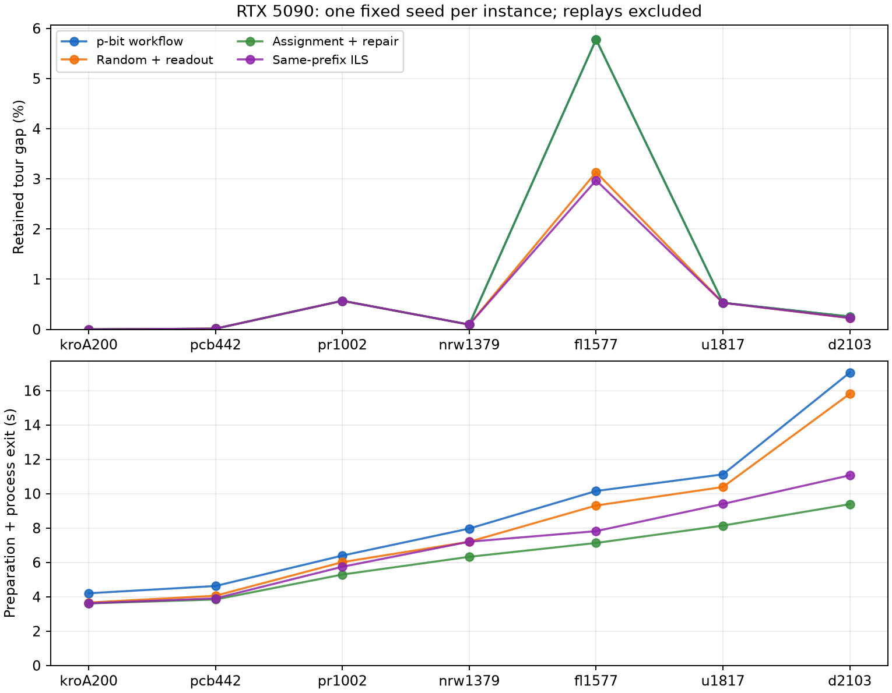

# RTX 5090候选网络p-bit流程：实测结果

[English](candidate-report.md) | 简体中文

**已在200–2103城的七个实例上实测p-bit混合流程，七例均未改善LKH前缀。** 唯一命中最优的kroA200，其最优解已经存在于经典前缀。本次公开GPU实现、完整测量结果及可复核证书，尚未建立p-bit的独立质量或速度优势。

## 方法、设备与冻结评估

[方法](candidate-network.zh-CN.md)由经典LKH初始化、候选弧GPU p-bit热浴更新、经典匹配与子环修复、CUDA整数2-opt及整数tour认证组成。二值网络表达受限assignment松弛，没有编码全局TSP连通性。经典支撑阶段、保留前缀与p-bit采样分别归因。

实际设备为**NVIDIA GeForce RTX 5090**，计算能力12.0，报告设备内存33,766,572,032字节；CPU为**AMD EPYC 9654 96-Core Emb Processor**。容器可见384个逻辑CPU及affinity条目，不表示独占这些CPU；未暴露统一cgroup CPU配额。LKH及数值库限制为单线程。记录Python 3.14.6、PyTorch 2.13.0+cu130、Triton 3.7.1及驱动615.71.09，固定LKH 3.0.13源码在该CPU上重建。

[冻结协议](../../data/tsp/candidate-network/protocol.json)包含**28次自然调用：7次p-bit流程、21次归因对照**，另有**1次d2103 p-bit原点回放**。每实例使用一个固定种子；所有实例与种子均已在私有开发中观察，本轮为设备确认，不声称未见实例泛化或成功概率。p-bit数值参数保持原样。根据所选资源用途，旧六方法计划中的独立LKH及GA-EAX性能调用在执行前明确排除；LKH仍作为共享初始化组件，并接受软件正确性夹具检查。

## 主要结果

已知最优值来自[TSPLIB](https://comopt.ifi.uni-heidelberg.de/software/TSPLIB95/tsp/TSP-BEST.html)，仅用作参考目标。“前缀后”指读出和下降后新产生的最好候选；“保留”允许继续使用起始tour。完整耗时包含源码准备、进程启动及执行至退出，不是纯GPU采样时间。

| 实例 | 节点数 | 最优值 | 前缀＝保留 | 前缀后 | 差距（%） | 完整秒 |
|---|---:|---:|---:|---:|---:|---:|
| kroA200 | 3200 | 29368 | 29368 | 31084 | 0.0000 | 4.203 |
| pcb442 | 7073 | 50778 | 50785 | 59893 | 0.0138 | 4.624 |
| pr1002 | 16037 | 259045 | 260520 | 340972 | 0.5694 | 6.395 |
| nrw1379 | 22065 | 56638 | 56692 | 76257 | 0.0953 | 7.968 |
| fl1577 | 25270 | 22249 | 23535 | 31069 | 5.7800 | 10.154 |
| u1817 | 29086 | 57201 | 57504 | 82885 | 0.5297 | 11.122 |
| d2103 | 33662 | 80450 | 80655 | 116060 | 0.2548 | 17.047 |

七行的前缀与保留长度均相同。前缀后候选更差，说明只展示最终保留tour会掩盖p-bit没有改进的事实。七个评估规模不等于七个p-bit最优解。最大单份网络为**33,662个二值节点**，无随机辅助位；**8个副本另列**。跨副本Torch allocated峰值为**36.30 MiB**，不包含完整驱动／上下文内存。未测量实体p-bit器件、芯片面积或能耗。

## 归因对照与完整成本

同一实例的四种方法均获得相同长度的前缀。按最终保留长度比较：

| 对照 | p-bit更好 | 相同 | p-bit更差 |
|---|---:|---:|---:|
| 随机位＋相同读出 | 0 | 5 | 2 |
| 精确assignment＋修复 | 0 | 7 | 0 |
| 同前缀ILS | 0 | 5 | 2 |



p-bit与assignment的质量曲线重合。assignment在每个观察到的配对中都以更短时间返回相同质量；这属于单种子观察，不是一般计时分布。随机读出及ILS在fl1577、d2103改善了保留tour，p-bit没有。协议采用固定工作量与时间上限，不是等实际计算量或等调参投入。

含回放的29次调用，准备加执行至退出累计**227.794秒**；七次自然p-bit调用累计**61.512秒**。它们的分项累计为**采样3.836秒、读出12.743秒、下降2.175秒、前缀10.064秒、网络准备8.400秒**。这些分项并不覆盖完整耗时；采样还包含位态采集、CPU能量计算及输出，不是CUDA event测得的纯kernel时间。环境准备、原生编译、独立审计和传输不计入227.794秒调用累计。runner与控制器封顶额度分别为1860与3600秒。

**224个自然p-bit退火边界位态**中，**4个**满足度数约束，分别仍含**23、28、30、65个子环**，**没有完整tour**。这些是相关的边界观察，不是独立试验。修复成tour不等于原始状态可行，更不等于达到完整TSP基态。

## 证据与复现

29次调用全部完成，修订面板没有失败、中断或未执行条目。核验器检查**1,451个tour观察及992个二值态**，包含对照／初始态及回放。原点回放匹配**65条非计时事件及26个数值数组**，不增加独立试验。另从归档独立恢复源码和输出，重新认证200城及2103城的p-bit调用。

[核心调用数据](../../data/tsp/candidate-network/rtx5090/calls.json)保留全部声明调用、返回tour和捕获位态；[指标](../../data/tsp/candidate-network/analysis/metrics.json)提供逐实例差距、前缀后质量及分项成本。不含坐标、原生源码包／二进制或私有操作记录。按协议取得字节匹配的外部输入后执行：

```bash
uv run --frozen python scripts/tsp/verify_candidate.py \
  --core data/tsp/candidate-network/rtx5090 \
  --instances-directory data/external/tsp
uv run --frozen python scripts/tsp/summarize_candidate.py \
  --core data/tsp/candidate-network/rtx5090 --output /tmp/tsp-analysis-NEW
```

以上命令验证数据并重绘图表，不执行求解器。新的GPU求解使用[方法指南](candidate-network.zh-CN.md)中的p-bit示例。

## 经典参照与边界

独立经典算法作为参照。另行提供的[u1817 CPU证书](../../data/tsp/candidate-network/u1817-optimum.json)记录GA-EAX在AMD Ryzen 9 5950X上达到57,201：四次自然调用三次命中，另有一次回放。该配置经过经典专项调参，使用500个体及180秒上限，既不是p-bit结果，也不构成同主机耗时比较。确认阶段未命中的结果仍保留在证书包中。

旧[150城RTX 5090报告](experiment-report.zh-CN.md)保留不同的CPU选择器／GPU局部搜索方法及原始分母。本轮证据支持已实现流程的规模与可复核性，没有证明胜过强TSP启发式、一般最优成功概率或硬件能耗优势。所用来源及完整既有研究文献清单由[方法参考清单](candidate-network.zh-CN.md)链接。
