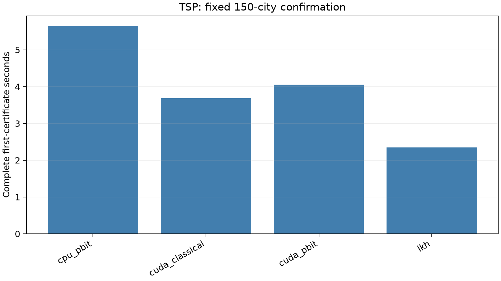

# RTX 5090 TSP确认

[English](experiment-report.md) | 简体中文

四种方法、四个固定种子、一个150城TSPLIB实例：**16次自然调用及一次另行LKH原点回放**。
这是既有冻结`kroA150`实例上的设备确认，边长采用TSPLIB EUC_2D整数取整，
整数目标为26524。种子为3200000, 3200010, 3200020, 3200030，每次runner截止上限30秒，
包含自身准备及搜索；外层源码准备／恢复和进程启动另计。混合方法的p-bit选择器运行在CPU上，
CUDA加速局部搜索；完整EAX比较仍未执行。

NVIDIA GeForce RTX 5090 (32607 MiB); AMD Eng Sample: 100-000001537-04 (quota 17.56 vCPU); Python 3.14.6; PyTorch 2.13.0+cu130; CUDA 13.0; driver 580.178.04.

| 方法 | 调用数 | 目标命中 | 完整首证书中位秒 | runner准备后中位秒 |
|---|---:|---:|---:|---:|
| cpu_pbit | 4 | 4 | 5.643 | 3.438 |
| cuda_classical | 4 | 4 | 3.686 | 0.406 |
| cuda_pbit | 4 | 4 | 4.054 | 0.758 |
| lkh | 4 | 4 | 2.350 | 0.165 |

完整首证书区间包括源码准备、恢复、进程启动、runner准备、前缀、搜索和认证。
较短区间保留runner准备后的前缀／搜索／认证。LKH首证书指适配器首次核验
已返回的完整tour，不是未被观测的程序内部首次找到该解的时间。共同包装开销会压低表面时间比，
不表示算法搜索成本相当。LKH中位更低，为2.350秒；
GPU辅助p-bit为4.054秒，配对时间比中位数为1.698。

全部保存tour观察均独立核验，公开核心包含每次调用的最好tour与首证书tour。
CPU／CUDA p-bit共同前缀及LKH原点回放均核对通过，不增加独立试验。
初始化、修复和polishing属于完整混合方法，命中不能自动归于独立p-bit模块。
不主张实体硬件或一般TSP优势。

[方法](README.zh-CN.md) · [核心数据](../../data/tsp/rtx5090/calls.json) ·
[核验](../../data/tsp/rtx5090/verification.json) · [复现](../reproduction.zh-CN.md)

## 参考来源与软件

下列入口保留研究中使用的背景及未实施对照。引用不表示复现；
方法说明中的版本与获取边界继续适用，本次发布没有重新进行一次全文文献审查。

- R1: [DOI](https://doi.org/10.1287/opre.2.4.393)
- R2: [https://publications.csail.mit.edu/lcs/pubs/pdf/MIT-LCS-TM-209.pdf](https://publications.csail.mit.edu/lcs/pubs/pdf/MIT-LCS-TM-209.pdf)
- R3: [https://doi.org/10.1007/s43069-021-00101-z](https://doi.org/10.1007/s43069-021-00101-z)
- R4: [arXiv v4](https://arxiv.org/abs/1708.04215v4)
- R5: [JACM](https://doi.org/10.1145/3424306)
- R6: [arXiv v6](https://arxiv.org/abs/2007.01409v6)
- R7: [https://doi.org/10.1287/opre.2022.2338](https://doi.org/10.1287/opre.2022.2338)
- R8: [arXiv v1](https://arxiv.org/abs/2212.06296v1)
- R9: [https://www.or.uni-bonn.de/tspbook/book.pdf](https://www.or.uni-bonn.de/tspbook/book.pdf)
- R10: [Cambridge](https://doi.org/10.1017/9781009445436)
- R11: [https://www.math.uwaterloo.ca/~bico/papers/tsp_icm.pdf](https://www.math.uwaterloo.ca/~bico/papers/tsp_icm.pdf)
- R12: [https://www.math.uwaterloo.ca/~bico/papers/clk_ijoc.pdf](https://www.math.uwaterloo.ca/~bico/papers/clk_ijoc.pdf)
- R13: [DOI](https://doi.org/10.1007/s12532-009-0004-6)
- R14: [https://www.math.uwaterloo.ca/tsp/data/art/tours/GA_tsp_art.pdf](https://www.math.uwaterloo.ca/tsp/data/art/tours/GA_tsp_art.pdf)
- R15: [Concorde](https://www.math.uwaterloo.ca/tsp/concorde/)
- R16: [pla85900](https://www.math.uwaterloo.ca/tsp/pla85900/index.html)
- R17: [DOI](https://doi.org/10.1145/2330784.2330978)
- R18: [arXiv v1](https://arxiv.org/abs/2003.11902v1)
- R19: [https://doi.org/10.1016/j.future.2020.01.011](https://doi.org/10.1016/j.future.2020.01.011)
- R20: [arXiv v2](https://arxiv.org/abs/2404.04895v2)
- R21: [https://doi.org/10.1145/3638530.3654394](https://doi.org/10.1145/3638530.3654394)
- R22: [arXiv v1](https://arxiv.org/abs/2608.21233v1)
- R23: [arXiv v3](https://arxiv.org/abs/1803.08475v3)
- R24: [arXiv v3](https://arxiv.org/abs/2010.16011v3)
- R25: [arXiv v1](https://arxiv.org/abs/2110.07983v1)
- R26: [arXiv v2](https://arxiv.org/abs/2207.03876v2)
- R27: [arXiv v2](https://arxiv.org/abs/2302.08224v2)
- R28: [DOI](https://doi.org/10.1126/science.3755256)
- R29: [DOI](https://doi.org/10.3389/fphy.2014.00005)
- R30: [https://doi.org/10.1103/plr8-xys1](https://doi.org/10.1103/plr8-xys1)
- R31: [https://doi.org/10.1038/s41928-023-01065-0](https://doi.org/10.1038/s41928-023-01065-0)
- R32: [https://doi.org/10.1038/s41467-024-47818-z](https://doi.org/10.1038/s41467-024-47818-z)
- R33: [https://doi.org/10.1038/s44335-026-00060-w](https://doi.org/10.1038/s44335-026-00060-w)
- R34: [https://doi.org/10.1038/s41467-025-66864-9](https://doi.org/10.1038/s41467-025-66864-9)
- R35: [https://arxiv.org/abs/2504.13294v1](https://arxiv.org/abs/2504.13294v1)
- R36: [DOI](https://doi.org/10.1109/LES.2023.3298739)
- R37: [arXiv v1](https://arxiv.org/abs/2607.21182v1)
- R38: [https://doi.org/10.1038/s41467-023-41647-2](https://doi.org/10.1038/s41467-023-41647-2)
- R39: [https://doi.org/10.1038/s41467-022-29411-4](https://doi.org/10.1038/s41467-022-29411-4)
- R40: [arXiv v1](https://arxiv.org/abs/2211.15869v1)
- R41: [arXiv v1](https://arxiv.org/abs/2202.08939v1)
- R42: [https://doi.org/10.3390/math10081294](https://doi.org/10.3390/math10081294)
- R43: [arXiv v2](https://arxiv.org/abs/2502.17725v2)
- R44: [arXiv v1](https://arxiv.org/abs/2604.25531v1)
- R45: [arXiv v4](https://arxiv.org/abs/2504.02388v4)
- R46: [https://doi.org/10.1145/3712255.3734313](https://doi.org/10.1145/3712255.3734313)
- R47: [https://doi.org/10.1587/transcom.2020NVI0002](https://doi.org/10.1587/transcom.2020NVI0002)
- R48: [TSPLIB95](https://comopt.ifi.uni-heidelberg.de/software/TSPLIB95/)
- R49: [nagata-yuichi/GA-EAX](https://github.com/nagata-yuichi/GA-EAX)
- R50: [RSkinderowicz/GPU-based-MMAS](https://github.com/RSkinderowicz/GPU-based-MMAS)
- R51: [EMI-Group/tensoraco](https://github.com/EMI-Group/tensoraco)
- R52: [attention-learn-to-route](https://github.com/wouterkool/attention-learn-to-route)
- R53: [yd-kwon/POMO](https://github.com/yd-kwon/POMO)
- R54: [liangxinedu/NeuroLKH](https://github.com/liangxinedu/NeuroLKH)
- R55: [JHL-HUST/VSR-LKH-V2](https://github.com/JHL-HUST/VSR-LKH-V2)
- R56: [Edward-Sun/DIFUSCO](https://github.com/Edward-Sun/DIFUSCO)
- R57: [souravsanyal06/Neuro-Ising](https://github.com/souravsanyal06/Neuro-Ising)
- R58: [IOPM02/Prob-Greedy-TSP](https://github.com/IOPM02/Prob-Greedy-TSP)
- R59: [kyshan/QPA](https://github.com/kyshan/QPA)
- R60: [DOI](https://doi.org/10.1137/0110015)
- R61: [DOI](https://doi.org/10.1145/290179.290180)
- R62: [Helsgaun (2000), An effective implementation of the Lin–Kernighan traveling salesman heuristic](https://doi.org/10.1016/S0377-2217%2899%2900284-2)
- R63: [DOI](https://doi.org/10.1287/ijoc.1120.0506)
- R64: [DOI](https://doi.org/10.1109/TCAD.2022.3164330)
- R65: [arXiv v1](https://arxiv.org/abs/2407.03927v1)
- R66: [arXiv v1](https://arxiv.org/abs/2505.00803v1)
- R67: [arXiv v1](https://arxiv.org/abs/2501.04072v1)
- R68: [arXiv v2](https://arxiv.org/abs/2501.14285v2)
- R69: [arXiv v1](https://arxiv.org/abs/2608.12772v1)
- R70: [arXiv v1](https://arxiv.org/abs/2608.09042v1)
- R71: [https://doi.org/10.1145/3712256.3726436](https://doi.org/10.1145/3712256.3726436)
- R72: [https://comopt.ifi.uni-heidelberg.de/software/TSPLIB95/tsp/TSP-BEST.html](https://comopt.ifi.uni-heidelberg.de/software/TSPLIB95/tsp/TSP-BEST.html)
- R73: [http://webhotel4.ruc.dk/~keld/research/LKH-3/LKH-3.0.13.tgz](http://webhotel4.ruc.dk/~keld/research/LKH-3/LKH-3.0.13.tgz)
- S1: [Python](https://www.python.org/)
- S2: [NumPy](https://numpy.org/)
- S3: [PyTorch](https://pytorch.org/)
- S4: [Triton](https://github.com/triton-lang/triton)
- S5: [CUDA](https://docs.nvidia.com/cuda/)
- S6: [SciPy](https://scipy.org/)
- S7: [Matplotlib](https://matplotlib.org/)
- S8: [PyYAML](https://pyyaml.org/)
- S9: [uv](https://docs.astral.sh/uv/)
- S10: [GCC](https://gcc.gnu.org/)
- S11: [pytest](https://docs.pytest.org/)
- S12: [Ruff](https://docs.astral.sh/ruff/)
